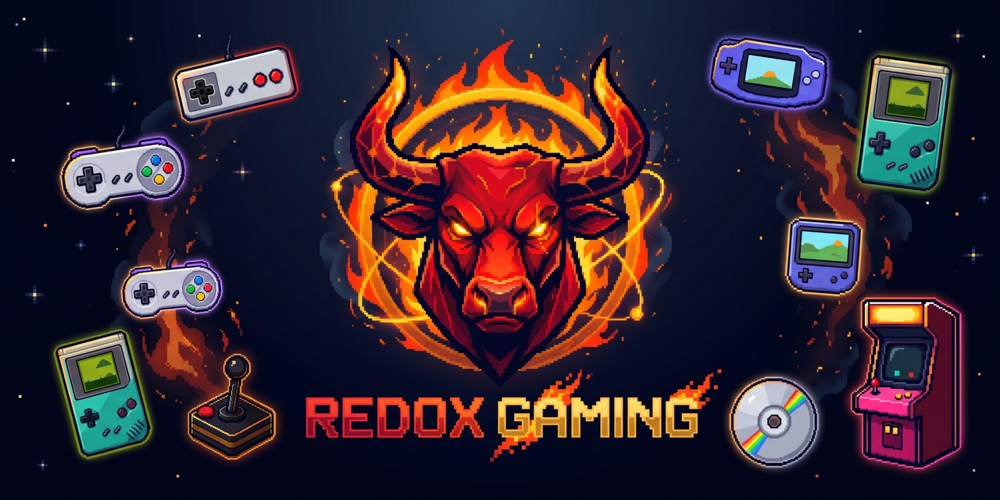
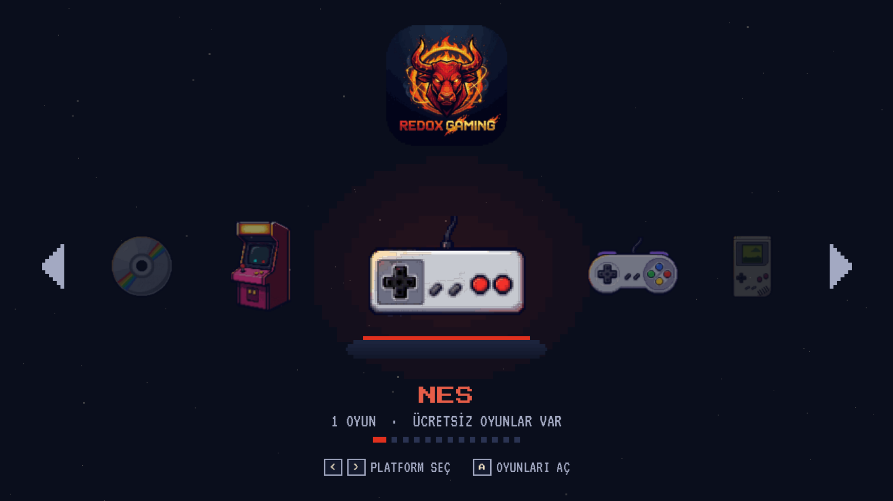
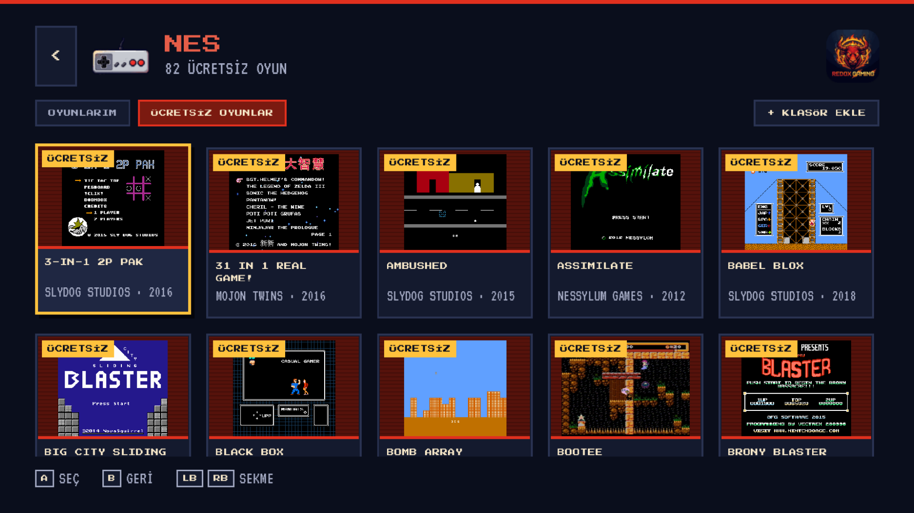
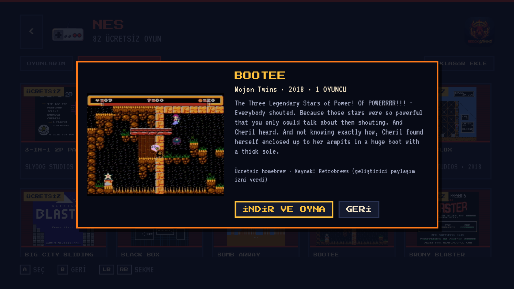
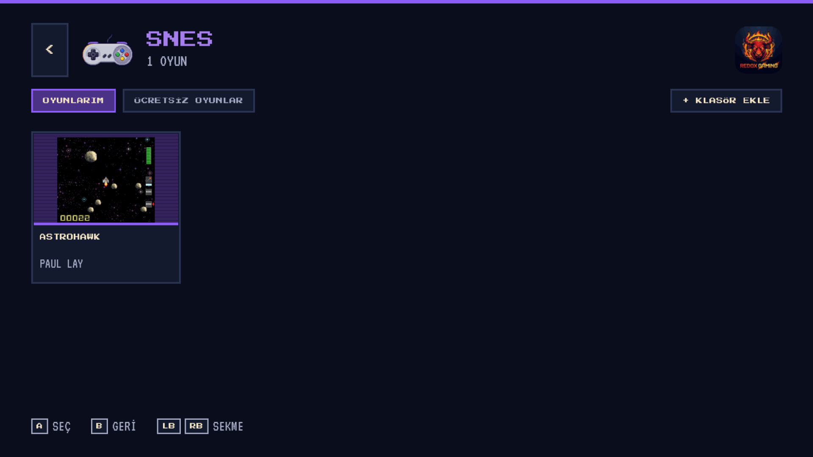
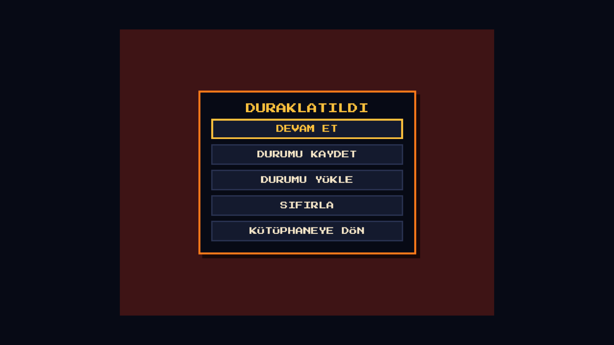
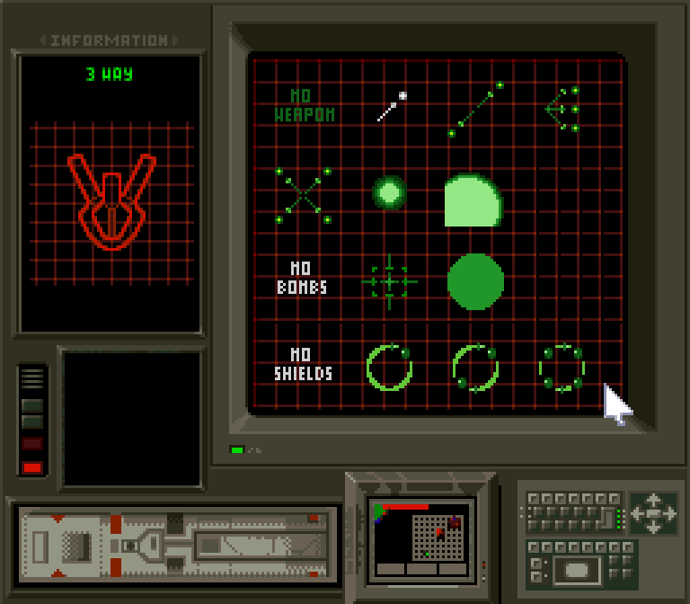

<p align="center">
  
</p>

<p align="center">
  <b>English</b> · <a href="README.tr.md">Türkçe</a>
</p>

# RedoX Gaming

**A free, open-source retro game player for Windows, Linux, Android TV and Android phones.**
Pixel-art interface built for the TV remote and gamepad, powered by the battle-tested
[libretro](https://www.libretro.com/) emulator cores and the [Godot 4](https://godotengine.org/) engine.

- 13 classic systems from one app: NES, SNES, Game Boy, Game Boy Color, Game Boy Advance, Mega Drive, Master System, Game Gear, PC Engine, Atari 2600, Neo Geo Pocket, PlayStation and Arcade
- **Free game store:** pick a legal homebrew game, it downloads and starts by itself
- **Your own games:** add a folder or a USB stick; box art is found automatically
- **Emulator cores on demand:** the right core is downloaded the first time you open a system
- **Resume where you left off**, 4 save-state slots with pictures, battery saves
- **Rewind** and **fast forward**, CRT / LCD / smooth picture filters
- **Cheats:** your own codes or one click in the libretro cheat database
- **RetroAchievements:** earn achievements in classic games (softcore and hardcore)
- **Recently played, favourites, play time,** search and sort
- **Settings:** Turkish / English, volume, controller and keyboard remapping, picture size
- On-screen gamepad for phones and tablets, menu sounds, new-version notice
- Everything works with a D-pad and two buttons

> RedoX Gaming does **not** include or download commercial games. You play free homebrew games or your own legally obtained game files.

---

## Screenshots

| Home: platform carousel | Free games |
|---|---|
|  |  |
| **Game details → Download & play** | **My games with box art** |
|  |  |
| **Pause menu** | **A downloaded SNES homebrew running** |
|  |  |

---

## Download

Grab the latest build from **[Releases](../../releases)**.

| Platform | Status |
|---|---|
| Windows 10/11 (x64) | ✅ `RedoXGaming-<version>-windows-x64.zip`: unzip, run `RedoXGaming.exe` |
| Linux (x64) | ✅ `RedoXGaming-<version>-linux-x64.tar.gz`: unpack, run `RedoXGaming.x86_64` |
| Android TV / Android phone (arm64 + 32-bit armeabi-v7a) | 🧪 `RedoXGaming-<version>-android.apk`: install the APK (allow "unknown sources"); not yet tested on many devices |

Requirements: OpenGL 3.3 capable GPU (any GPU from the last ~12 years), internet only for the free store, box art and first-time core downloads.

## Supported systems

| System | Files | Core (downloaded automatically) | Free games |
|---|---|---|---|
| NES / Famicom | `.nes .fds .unf` | FCEUmm | ✅ 82 |
| SNES / Super Famicom | `.sfc .smc` | Snes9x | ✅ 14 |
| Game Boy | `.gb` | Gambatte | ✅ |
| Game Boy Color | `.gbc` | Gambatte | ✅ 8 |
| Game Boy Advance | `.gba` | mGBA | ✅ 88 |
| Sega Mega Drive / Genesis | `.md .gen .smd` (`.bin` in a Mega Drive folder) | Genesis Plus GX | ✅ 62 |
| Sega Master System | `.sms` | Genesis Plus GX | ✅ 65 |
| Sega Game Gear | `.gg` | Genesis Plus GX | — |
| PC Engine / TurboGrafx-16 | `.pce` | Beetle PCE Fast | — |
| Atari 2600 | `.a26` (`.bin` in an Atari folder) | Stella | ✅ 24 |
| Neo Geo Pocket (Color) | `.ngp .ngc` | Beetle NeoPop | — |
| PlayStation | `.cue .chd .pbp` (BIOS required) | PCSX ReARMed | — |
| Arcade | `.zip` in an Arcade/FBNeo folder | FBNeo | — |

## Controls

| Action | Keyboard | Gamepad |
|---|---|---|
| Move / choose | Arrow keys | D-pad or left stick |
| Confirm in menus | `Enter` | bottom face button (Xbox A / PlayStation ✕) |
| Back in menus | `Esc` / Android back | right face button (Xbox B / ○) |
| In game: **A** | `X` | right face button |
| In game: **B** | `Z` | bottom face button |
| In game: **X / Y** | `S` / `A` | top / left face button |
| In game: L / R | `Q` / `W` | LB / RB |
| In game: Start / Select | `Enter` / `Shift` | Start / Back (View) |
| Switch tabs | `Q` / `E` | LB / RB |
| Favourite / search / sort | `F` / `/` / `O` | X / Y / Select |
| Continue last game · settings (home) | `C` · `S` | Y · Start |
| Rewind (hold) | `R` | LT / L2 |
| Fast forward (hold) | `Space` | RT / R2 |
| Pause menu (in game) | `Esc` | Select + Start, or Guide |
| Quick save / load (slot 1) | `F2` / `F4` | pause menu |

In-game buttons follow the SNES layout by **position**, so the game's A is always the right button. Every key and button can be changed in **Settings → Controls**. More in the wiki: [Using RedoX Gaming](../../wiki/Using-RedoX-Gaming), [RetroAchievements](../../wiki/RetroAchievements).

## Adding your own games

1. Open a system → **+ ADD FOLDER** → pick a folder, a USB stick or a network share.
2. Sub-folders are scanned; files stay where they are (nothing is copied).
3. Box art is downloaded from [libretro-thumbnails](https://github.com/libretro-thumbnails/libretro-thumbnails) when the file name matches the No-Intro name (e.g. `Super Mario Bros. (World).nes`).

You can also copy files to the app's ROM folder: `%APPDATA%\Godot\app_userdata\RedoX Gaming\roms\<system>\` on Windows.

## Free games

The **FREE GAMES** tab lists homebrew games from [Retrobrews](https://retrobrews.github.io): new games made for old consoles, shared by their authors. Retrobrews states that every listed game was approved for sharing by its owner; RedoX Gaming shows the developer and the source on every game.

## Build from source

```bash
git clone --recursive https://github.com/ByReDoxXx/redox-gaming.git
cd redox-gaming/extension
scons platform=windows target=template_release     # or: platform=linux
```

Then open `app/` with Godot 4.7 and press **F5**, or export with the included preset.
Full instructions, Linux and Android: **[docs/TECHNICAL.md](docs/TECHNICAL.md#building)** and the **[Wiki](../../wiki)**.

## Documentation

| | English | Türkçe |
|---|---|---|
| Technical documentation | [docs/TECHNICAL.md](docs/TECHNICAL.md) | [docs/TEKNIK.md](docs/TEKNIK.md) |
| Design system | [docs/DESIGN.md](docs/DESIGN.md) | |
| Wiki (install, usage, FAQ, building) | [Wiki → Home](../../wiki) | [Wiki → Ana Sayfa](../../wiki/Ana-Sayfa) |

## Roadmap

- [x] libretro host (video, audio, input, save states, battery saves)
- [x] Pixel-art TV interface, platform carousel, pause menu
- [x] Free homebrew store, folder/USB import, box art, cores on demand
- [x] Windows release
- [x] Settings screen: language, controller remapping, picture size, CRT / LCD filters
- [x] Favourites, recently played, play time, search and sort
- [x] Rewind, fast forward, 4 save slots, resume where you left off
- [x] Cheats (own codes + libretro cheat database), RetroAchievements
- [x] Linux build, Android APK, on-screen touch controls, CI builds on GitHub Actions
- [ ] Android TV testing on more devices, TV launcher banner
- [ ] Linux AppImage / Flatpak
- [ ] Netplay, audio latency setting, hardware-rendered cores (N64, PSP)

## License

RedoX Gaming is licensed under the **GNU General Public License v3.0**; see [LICENSE](LICENSE).

Third-party parts keep their own licenses:

| Component | License |
|---|---|
| [godot-cpp](https://github.com/godotengine/godot-cpp) | MIT |
| [libretro.h](https://github.com/libretro/libretro-common) | MIT |
| libretro cores (downloaded at runtime, not bundled) | their own: GPL, or non-commercial for Snes9x / Genesis Plus GX / FBNeo |
| [Press Start 2P](https://fonts.google.com/specimen/Press+Start+2P), [VT323](https://fonts.google.com/specimen/VT323) | SIL Open Font License |
| Free game list and screenshots | [Retrobrews](https://retrobrews.github.io) and each game's author |
| Box art | [libretro-thumbnails](https://github.com/libretro-thumbnails/libretro-thumbnails) |

Console names are used only to describe compatibility. All trademarks belong to their owners; RedoX Gaming is not affiliated with Nintendo, Sega, Sony, NEC, Atari or SNK.
