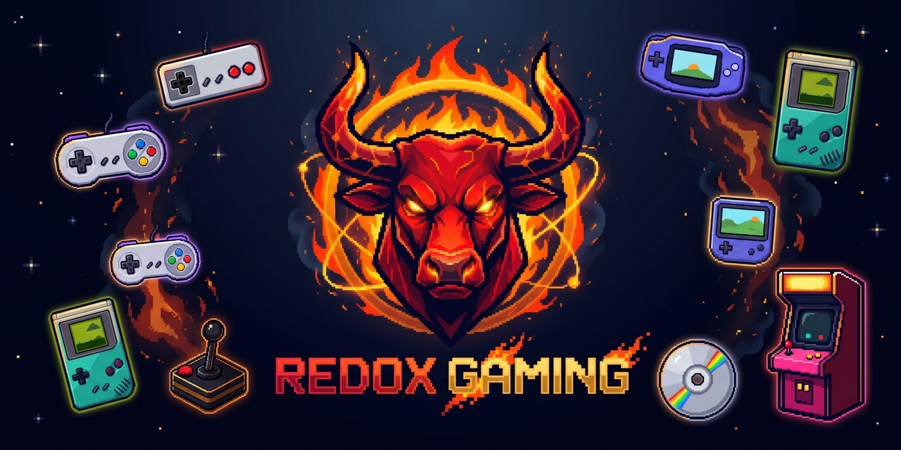
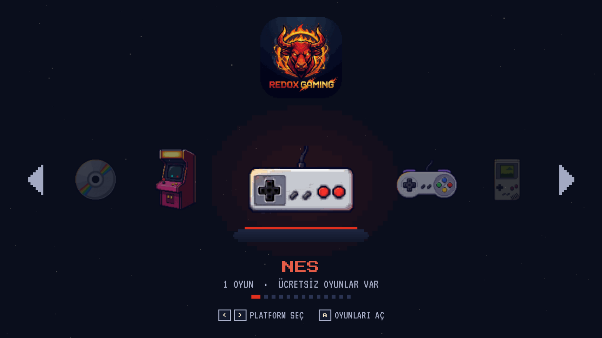
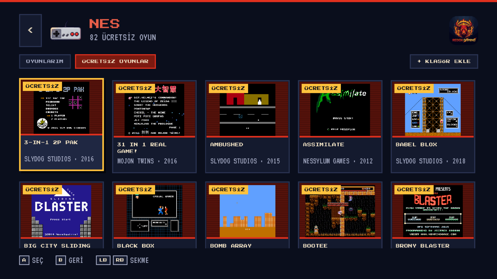
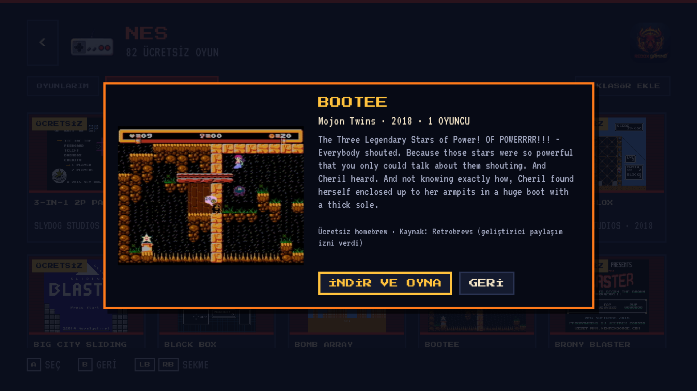
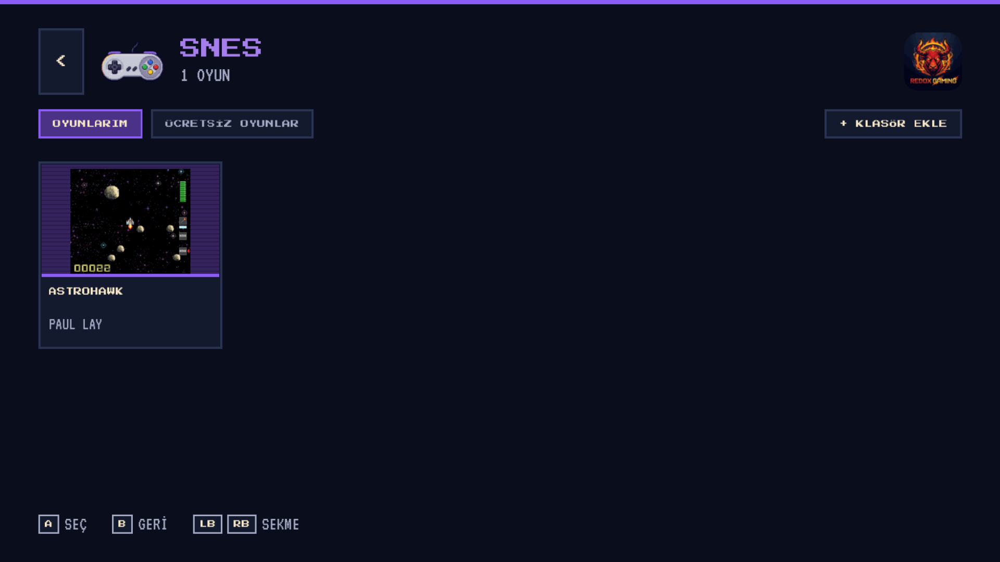
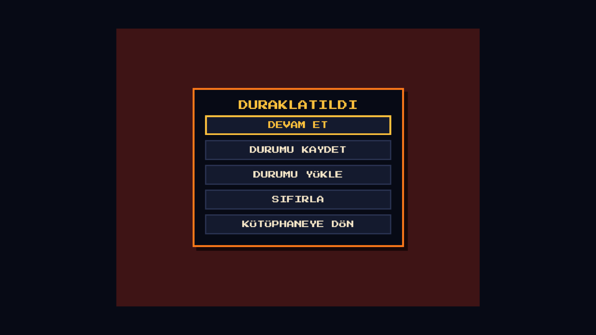
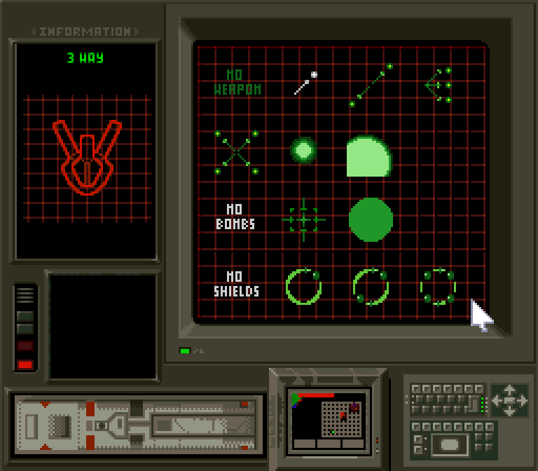

<p align="center">
  
</p>

<p align="center">
  <a href="README.md">English</a> · <b>Türkçe</b>
</p>

# RedoX Gaming

**Windows, Linux, Android TV ve Android telefon için ücretsiz ve açık kaynak retro oyun oynatıcı.**
TV kumandası ve gamepad için tasarlanmış pixel art arayüz; arkasında yıllardır test edilen
[libretro](https://www.libretro.com/) emülatör çekirdekleri ve [Godot 4](https://godotengine.org/) motoru var.

- Tek uygulamada 13 klasik sistem: NES, SNES, Game Boy, Game Boy Color, Game Boy Advance, Mega Drive, Master System, Game Gear, PC Engine, Atari 2600, Neo Geo Pocket, PlayStation ve Arcade
- **Ücretsiz oyun mağazası:** yasal bir homebrew oyun seçin, kendiliğinden iner ve başlar
- **Kendi oyunlarınız:** bir klasör ya da USB bellek ekleyin, kapak resimleri otomatik bulunur
- **İhtiyaç anında çekirdek:** bir sistemi ilk açtığınızda doğru emülatör çekirdeği bir kez indirilir
- Durum kaydetme, pil kayıtları, duraklatma menüsü, tam sayı ölçekli keskin görüntü
- Her şey bir yön tuşu ve iki düğmeyle kullanılabilir

> RedoX Gaming ticari oyun **içermez ve indirmez**. Ücretsiz homebrew oyunları ya da yasal yoldan edindiğiniz kendi oyun dosyalarınızı oynarsınız.

---

## Ekran görüntüleri

| Ana ekran: platform carousel | Ücretsiz oyunlar |
|---|---|
|  |  |
| **Oyun detayı → İndir ve oyna** | **Kapak resimleriyle Oyunlarım** |
|  |  |
| **Duraklatma menüsü** | **İndirilen bir SNES homebrew oyunu çalışırken** |
|  |  |

---

## İndirme

En son sürüm **[Releases](../../releases)** sayfasında.

| Platform | Durum |
|---|---|
| Windows 10/11 (x64) | ✅ `RedoXGaming-windows-x64.zip`: zip'i açın, `RedoXGaming.exe`'yi çalıştırın |
| Linux (x64) | 🛠️ kaynaktan derlenebilir, paketli sürüm yolda |
| Android TV / Android telefon (arm64) | 🛠️ bir sonraki sürümde |

Gereksinimler: OpenGL 3.3 destekleyen ekran kartı (son ~12 yılın her kartı). İnternet yalnızca ücretsiz mağaza, kapak resimleri ve ilk çekirdek indirmesi için gerekir.

## Desteklenen sistemler

| Sistem | Dosyalar | Çekirdek (otomatik iner) | Ücretsiz oyun |
|---|---|---|---|
| NES / Famicom | `.nes .fds .unf` | FCEUmm | ✅ 82 |
| SNES / Super Famicom | `.sfc .smc` | Snes9x | ✅ 14 |
| Game Boy | `.gb` | Gambatte | ✅ |
| Game Boy Color | `.gbc` | Gambatte | ✅ 8 |
| Game Boy Advance | `.gba` | mGBA | ✅ 88 |
| Sega Mega Drive / Genesis | `.md .gen .smd` (Mega Drive klasöründe `.bin`) | Genesis Plus GX | ✅ 62 |
| Sega Master System | `.sms` | Genesis Plus GX | ✅ 65 |
| Sega Game Gear | `.gg` | Genesis Plus GX | — |
| PC Engine / TurboGrafx-16 | `.pce` | Beetle PCE Fast | — |
| Atari 2600 | `.a26` (Atari klasöründe `.bin`) | Stella | ✅ 24 |
| Neo Geo Pocket (Color) | `.ngp .ngc` | Beetle NeoPop | — |
| PlayStation | `.cue .chd .pbp` (BIOS gerekir) | PCSX ReARMed | — |
| Arcade | Arcade/FBNeo klasöründe `.zip` | FBNeo | — |

## Kontroller

| İşlem | Klavye | Gamepad |
|---|---|---|
| Gezinme / seçme | Yön tuşları | Yön tuşu veya sol çubuk |
| Menüde onay | `Enter` | alt düğme (Xbox A / PlayStation ✕) |
| Menüde geri | `Esc` / Android geri | sağ düğme (Xbox B / ○) |
| Oyunda **A** | `X` | sağ düğme |
| Oyunda **B** | `Z` | alt düğme |
| Oyunda **X / Y** | `S` / `A` | üst / sol düğme |
| Oyunda L / R | `Q` / `W` | LB / RB |
| Oyunda Start / Select | `Enter` / `Shift` | Start / Back (View) |
| Sekme değiştir | `Q` / `E` | LB / RB |
| Oyun içi menü | `Esc` | Select + Start ya da Guide |
| Hızlı kaydet / yükle | `F2` / `F4` | oyun içi menü |

Oyun içindeki düğmeler SNES düzenine **konuma göre** eşlenir; oyunun A'sı her zaman sağdaki düğmedir.

## Kendi oyunlarınızı ekleme

1. Bir sistemi açın → **+ KLASÖR EKLE** → bir klasör, USB bellek ya da ağ paylaşımı seçin.
2. Alt klasörler de taranır; dosyalar yerinde kalır, hiçbir şey kopyalanmaz.
3. Dosya adı No-Intro adıyla eşleşirse (örn. `Super Mario Bros. (World).nes`) kapak resmi [libretro-thumbnails](https://github.com/libretro-thumbnails/libretro-thumbnails)'ten iner.

Dosyaları uygulamanın ROM klasörüne de kopyalayabilirsiniz: Windows'ta `%APPDATA%\Godot\app_userdata\RedoX Gaming\roms\<sistem>\`.

## Ücretsiz oyunlar

**ÜCRETSİZ OYUNLAR** sekmesi [Retrobrews](https://retrobrews.github.io)'teki homebrew oyunları listeler: eski konsollar için yapılmış ve geliştiricilerinin paylaştığı yeni oyunlar. Retrobrews listedeki her oyunun paylaşımına sahibinin izin verdiğini belirtir; RedoX Gaming her oyunda geliştiriciyi ve kaynağı gösterir.

## Kaynaktan derleme

```bash
git clone --recursive https://github.com/ByReDoxXx/redox-gaming.git
cd redox-gaming/extension
scons platform=windows target=template_release     # ya da: platform=linux
```

Ardından `app/` klasörünü Godot 4.7 ile açıp **F5**'e basın ya da hazır çıktı ayarıyla dışa aktarın.
Ayrıntılı anlatım, Linux ve Android: **[docs/TEKNIK.md](docs/TEKNIK.md#derleme)** ve **[Wiki](../../wiki/Ana-Sayfa)**.

## Dokümanlar

| | Türkçe | English |
|---|---|---|
| Teknik doküman | [docs/TEKNIK.md](docs/TEKNIK.md) | [docs/TECHNICAL.md](docs/TECHNICAL.md) |
| Tasarım sistemi | | [docs/DESIGN.md](docs/DESIGN.md) |
| Wiki (kurulum, kullanım, SSS, derleme) | [Wiki → Ana Sayfa](../../wiki/Ana-Sayfa) | [Wiki → Home](../../wiki) |

## Yol haritası

- [x] libretro host (görüntü, ses, giriş, durum kaydı, pil kayıtları)
- [x] Pixel art TV arayüzü, platform carousel, duraklatma menüsü
- [x] Ücretsiz homebrew mağazası, klasör/USB ekleme, kapak resimleri, ihtiyaç anında çekirdek
- [x] Windows sürümü
- [ ] Android TV / telefon (APK), telefon için ekran üstü dokunmatik kontroller
- [ ] Linux sürümü (AppImage)
- [ ] Ayarlar ekranı: tuş atama, shader'lar (CRT / tarama çizgisi), ses gecikmesi
- [ ] Favoriler ve son oynananlar
- [ ] Geri sarma ve hızlı ileri

## Lisans

RedoX Gaming **GNU General Public License v3.0** ile lisanslanmıştır; bkz. [LICENSE](LICENSE).

Üçüncü taraf parçalar kendi lisanslarını korur:

| Bileşen | Lisans |
|---|---|
| [godot-cpp](https://github.com/godotengine/godot-cpp) | MIT |
| [libretro.h](https://github.com/libretro/libretro-common) | MIT |
| libretro çekirdekleri (çalışırken iner, pakete dahil değil) | kendi lisansları: GPL, ya da Snes9x / Genesis Plus GX / FBNeo için ticari olmayan kullanım |
| [Press Start 2P](https://fonts.google.com/specimen/Press+Start+2P), [VT323](https://fonts.google.com/specimen/VT323) | SIL Open Font License |
| Ücretsiz oyun listesi ve ekran görüntüleri | [Retrobrews](https://retrobrews.github.io) ve her oyunun geliştiricisi |
| Kapak resimleri | [libretro-thumbnails](https://github.com/libretro-thumbnails/libretro-thumbnails) |

Konsol adları yalnızca uyumluluğu belirtmek için kullanılır. Tüm markalar sahiplerine aittir; RedoX Gaming'in Nintendo, Sega, Sony, NEC, Atari veya SNK ile bir bağlantısı yoktur.
