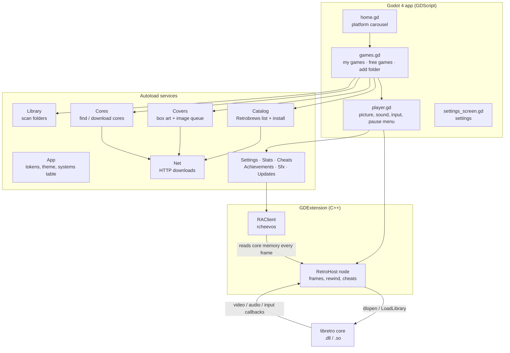
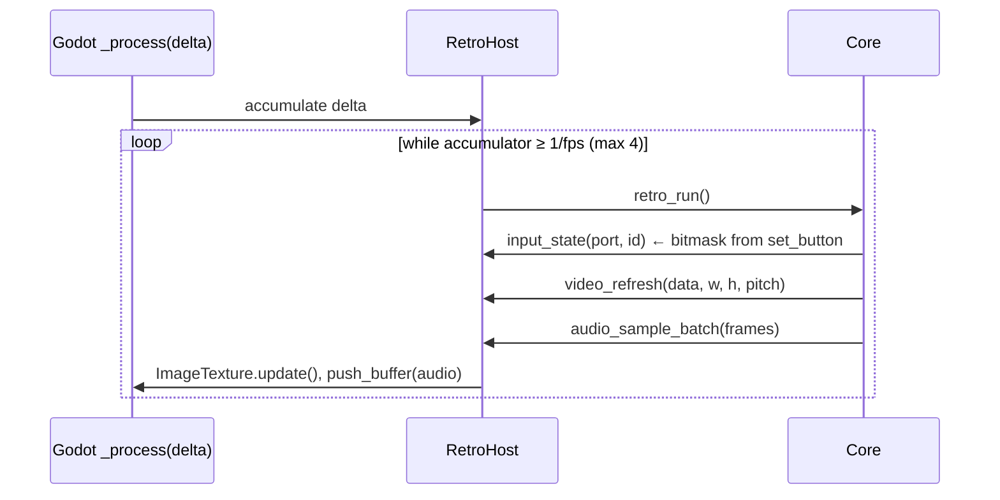

# RedoX Gaming: Technical Documentation

[Türkçe](TEKNIK.md) · **English**

This document explains how RedoX Gaming is built: the parts, how a frame travels from an emulator core to the screen, the online services, the files on disk, how to build every platform, and how to extend the app.

- [1. Architecture](#1-architecture)
- [2. Repository layout](#2-repository-layout)
- [3. The libretro host (C++)](#3-the-libretro-host-c)
- [4. Godot application](#4-godot-application)
- [5. Online services](#5-online-services)
- [6. Files on disk](#6-files-on-disk)
- [7. Building](#building)
- [8. Testing](#8-testing)
- [9. Extending](#9-extending)
- [10. Known limitations](#10-known-limitations)

---

## 1. Architecture



Three layers:

| Layer | Language | Job |
|---|---|---|
| **Interface** | GDScript (Godot 4.7) | screens, navigation, design system, online services |
| **RetroHost** | C++ (GDExtension, godot-cpp 4.5 API) | loads a libretro core, runs frames, converts video and audio, feeds input, save states |
| **Cores** | C/C++ (third party) | the actual emulators, one shared library per system |

The engine runs the **GL Compatibility** renderer (OpenGL 3.3 / OpenGL ES 3.0) so that cheap Android TV boxes work.

## 2. Repository layout

```
redox-gaming/
├── app/                          Godot project (open this folder in Godot)
│   ├── project.godot             settings, autoloads, splash, icon
│   ├── export_presets.cfg        Windows, Linux and Android export presets
│   ├── redox_core.gdextension    which native library to load per platform
│   ├── bin/<platform>/           built RetroHost libraries (not in git)
│   ├── cores/<platform>/         optional bundled cores for development (not in git)
│   ├── roms/redox_test.nes       our own 145-byte test program
│   ├── assets/
│   │   ├── svg/                  logo, app icon, platform illustrations (pixel-art SVG)
│   │   ├── brand/                splash, .ico, Android launcher icons, TV banner
│   │   ├── fonts/                Press Start 2P, VT323 (OFL)
│   │   └── systems*/             raster sources of the icons
│   ├── scenes/                   home, games, player, settings (root + script only)
│   ├── shaders/                  crt, lcd, smooth picture filters
│   ├── scripts/
│   │   ├── app.gd                design tokens, theme, systems table, helpers
│   │   ├── home.gd · games.gd · player.gd · settings_screen.gd
│   │   ├── strings.gd            every interface text in Turkish and English
│   │   ├── retro_input.gd        keyboard / gamepad → libretro joypad bits
│   │   ├── services/             net, cores, library, catalog, covers, settings, stats,
│   │   │                         sfx, updates, cheats, achievements
│   │   └── ui/                   game_card.gd, hint_bar.gd, touch_pad.gd
│   └── tests/                    smoke_test, services_test, online_test, svg_preview
├── extension/                    C++ GDExtension
│   ├── SConstruct
│   ├── godot-cpp/                git submodule (branch 4.5)
│   ├── rcheevos/                 git submodule (RetroAchievements, v12.5.0, MIT)
│   ├── include/libretro.h
│   └── src/                      retro_host.*, ra_client.*, dynlib.*, register_types.cpp
├── art/                          original artwork (Gemini) used to generate assets
├── tools/                        Python scripts: icons, SVGs, brand files, test ROM, cores
├── .github/workflows/build.yml   CI: builds and publishes Windows, Linux and Android
└── docs/                         this file, design system, screenshots
```

## 3. The libretro host (C++)

`RetroHost` is a `Node` registered by the GDExtension. One instance owns one core at a time (libretro callbacks have no user pointer, so a static pointer routes them).

### 3.1 Public API (callable from GDScript)

| Method | Description |
|---|---|
| `load_core(path) -> bool` | opens the shared library, resolves all 21 `retro_*` symbols, calls `retro_set_environment` and `retro_init` |
| `load_game(path) -> bool` | reads the file (or passes the path when the core sets `need_fullpath`), calls `retro_load_game`, reads AV info, loads battery save, starts processing |
| `unload_game()` / `unload_core()` | writes the battery save, unloads |
| `reset()` | `retro_reset` |
| `set_paused(bool)` / `step_frame()` | pause the clock / run exactly one frame (used by tests) |
| `set_button(port, id, pressed)` / `clear_input()` | joypad state, ids are `RETRO_DEVICE_ID_JOYPAD_*` (0–15), ports 0–3 |
| `get_texture() -> ImageTexture` | the picture; the same texture object is updated in place every frame |
| `get_frame_image()`, `get_frame_size()`, `get_aspect_ratio()`, `get_fps()`, `get_sample_rate()` | frame info |
| `set_audio_playback(AudioStreamGeneratorPlayback)` | where sound is pushed |
| `set_system_directory(dir)` / `set_save_directory(dir)` | BIOS and battery-save folders handed to the core |
| `save_state() -> PackedByteArray` / `load_state(data) -> bool` | `retro_serialize` / `retro_unserialize` |
| `get_core_info() -> Dictionary` | name, version, extensions, fps, sample rate |
| `set_speed(float)` | 1.0 normal, 2–8 fast forward (sound of only one frame per tick is kept) |
| `set_rewind_enabled(bool)` / `set_rewind_budget_mb(int)` / `set_rewinding(bool)` / `get_rewind_depth()` | rewind buffer, see 3.5 |
| `cheat_reset()` / `cheat_set(index, enabled, code)` | `retro_cheat_reset` / `retro_cheat_set` (optional symbols) |
| `get_memory(id) -> PackedByteArray` | copy of `RETRO_MEMORY_*` (save RAM, system RAM…) |
| signal `video_size_changed(Vector2i)` | emitted when the core changes resolution |

### 3.2 Frame loop



- **Timing:** the host accumulates real time and runs as many core frames as fit (at most 4 per Godot frame), so a 60.1 fps NES stays in step with a 60 Hz display. After a long stall the accumulator is reset instead of fast-forwarding.
- **Video:** the three libretro pixel formats (`XRGB8888`, `RGB565`, `0RGB1555`) are converted row by row (respecting `pitch`) into RGBA8, written into one reused `Image` and uploaded with `ImageTexture.update()`. A `NULL` frame (dupe) keeps the last picture.
- **Audio:** interleaved `int16` stereo becomes `Vector2` floats and is pushed into an `AudioStreamGeneratorPlayback` whose `mix_rate` equals the core's sample rate. If the buffer is full, that frame's audio is dropped rather than blocking.
- **Input:** the core can ask per button or for the whole bitmask (`RETRO_DEVICE_ID_JOYPAD_MASK`).

### 3.3 Environment commands handled

`GET_LOG_INTERFACE`, `SET_PIXEL_FORMAT`, `GET_CAN_DUPE`, `GET_SYSTEM_DIRECTORY`, `GET_SAVE_DIRECTORY`, `GET_INPUT_BITMASKS`, `SET_VARIABLES` (defaults are the first listed value), `GET_VARIABLE`, `GET_VARIABLE_UPDATE`, `SET_GEOMETRY`, `SET_SYSTEM_AV_INFO`, and the informational `SET_INPUT_DESCRIPTORS`, `SET_CONTROLLER_INFO`, `SET_SUPPORT_ACHIEVEMENTS`, `SET_PERFORMANCE_LEVEL`. Everything else returns `false`, which every supported core handles. Hardware-rendered cores (`SET_HW_RENDER`) are not supported yet.

`SET_MEMORY_MAPS` is also handled: the descriptors are copied and given to rcheevos so achievements can read the console's memory.

### 3.4 Loading cores

`dynlib.cpp` wraps `LoadLibraryExW` (Windows, UTF-8 → UTF-16 path, `LOAD_LIBRARY_SEARCH_DLL_LOAD_DIR`) and `dlopen` (Linux / Android). It lives in its own file so `<windows.h>` never meets the godot-cpp headers.

### 3.5 Rewind

While rewind is enabled the host serializes the core every second frame. Only the newest state is kept whole; every older state is stored as the **XOR with its successor, run-length coded** (`[equal run][literal length][xor bytes]…`). Two consecutive emulator states differ in a few hundred bytes, so a delta is tiny (an NES delta is usually under 1 KB). The deltas live in a deque capped at 48 MB; the oldest are dropped first.

Rewinding pops one delta per frame: `state ^= delta` gives the previous state, `retro_unserialize` loads it, and one silent frame is run so the picture updates. At the oldest state the picture holds still. A size change (some cores grow their state) clears the buffer.

### 3.6 Achievements: `RAClient`

`RAClient` (also a `Node`) wraps rcheevos' `rc_client`. rcheevos does not do networking itself: each request becomes the signal `http_request(id, url, post_data, content_type)`; `Achievements` (GDScript) sends it with `Net.request()` and answers with `http_response(id, status, body)`, which calls rcheevos' callback. Everything runs on the main thread.

| Method / signal | Description |
|---|---|
| `login_with_password(user, password)` / `login_with_token(user, token)` → `login_done(ok, message)` | the app keeps only the token |
| `load_game(host, path, console_id)` → `game_loaded(ok, message)` | hashes the ROM (from memory when the host has it) and starts a session |
| `get_game()`, `get_achievements()`, `get_user()`, `get_rich_presence()` | data for the pause-menu page |
| `set_hardcore(bool)` | rcheevos' hardcore flag; the app also disables rewind, state loading and cheats |
| `event(type, data)` | `unlocked`, `completed`, `progress`, `lb_*`, `server_error`, `disconnected`, … |

`RetroHost` calls `do_frame()` after every `retro_run()`, `idle()` while paused, `on_reset()` on reset and `on_state_loaded()` after a state load (progress is restarted, since states do not store it). Memory is read through `rc_libretro_memory_init()` with the core's memory map (or `retro_get_memory_data` when there is none).

## 4. Godot application

### 4.1 Screens

| Screen | Script | What it does |
|---|---|---|
| Home | `home.gd` | logo, platform carousel (wraps around, 180 ms slide, never auto-rotates), name, game count, position dots. "Recent" and "Favourites" lead the carousel when not empty. A opens a platform, Y continues the last game, START opens settings; gear button and update badge for mouse/touch. |
| Games | `games.gd` | tabs **MY GAMES** / **FREE GAMES**, search box, sort (A-Z, last played, most played), **+ ADD FOLDER**; 5-column grid of `GameCard`s (play time, favourite star); detail dialog; core download dialog. Also shows the cross-platform lists `recent` and `favorites`. |
| Player | `player.gd` | creates `RetroHost`; picture size (pixel perfect / fit / stretch) and filter shader; sound; input incl. rewind / fast-forward hotkeys and the on-screen pad; automatic resume state; pause menu with 4 save slots (picture + date), cheats, achievements, restart, back to library. |
| Settings | `settings_screen.gd` | one list of rows by section; left/right changes a value, A opens sub-pages (key remapping, pad remapping, RetroAchievements sign-in). Changing the language rebuilds the screen. |

All screens are built in code; the `.tscn` files only hold the root node and its script. Every screen is usable with D-pad + A/B; the design rules are in [DESIGN.md](DESIGN.md).

### 4.2 Input

`retro_input.gd` reads the keyboard and up to two gamepads every frame and writes a 16-bit mask per port. Face buttons map by **position** (SNES layout): bottom = B, right = A, left = Y, top = X; the left stick also drives the D-pad. Key presses are additionally **latched** from input events, so a tap shorter than one frame still reaches the game. Select + Start (or Guide) opens the pause menu.

Remapping is stored in Settings (`keys`, `pad`) and applied by `RetroInput.load_bindings()` over the defaults. Rewind is held on keyboard `R` or the left trigger, fast forward on `Space` or the right trigger; on PlayStation the triggers stay game buttons. `TouchPad` (`ui/touch_pad.gd`) is a multi-touch overlay whose D-pad reads 8 directions from the finger's angle; it writes `RetroInput.touch_mask`, which is OR-ed into port 0.

Systems marked `"touch": true` in `App.SYSTEMS` (Nintendo DS) also get a touch screen: `player.gd` turns a left click or a finger (Android emulates the mouse from touches) on the game picture into `RetroHost.set_pointer(x, y, pressed)` with x, y in 0..1 of the frame. The host answers `RETRO_DEVICE_POINTER` (X, Y, PRESSED, COUNT) on port 0 and reports joypad + pointer for `GET_INPUT_DEVICE_CAPABILITIES`. `tests/touch_test.tscn` taps a point of the picture and saves screenshots before and after.

### 4.3 Systems table

`App.SYSTEMS` is the single source of truth: id, display name, accent colour, core file name and extensions. Screens, the library scanner, the core downloader and the box-art lookup all read it.

### 4.4 Settings, play history, sounds, languages

| Autoload | File | Job |
|---|---|---|
| `Settings` | `services/settings.gd` | preferences in `user://settings.json`; `get_value` / `set_value` (saves and emits `changed(key)`); applies volume and fullscreen |
| `Stats` | `services/stats.gd` | per game: seconds played, last played, favourite (`user://stats.json`); `recent()`, `favorites()`, formatting |
| `SpaceBackdrop` | `ui/space_backdrop.gd` | home screen background: 3 parallax star layers, twinkling, shooting stars, and short scenes with the sprites from `assets/space/` (asteroid*, ufo*, ship*) in the band above the carousel: a ship chases and shoots a UFO, the UFO wins now and then, a ship shoots an asteroid to pieces, a ship crashes into an asteroid, two asteroids collide. Lasers, plasma, explosions and debris are pixel particles drawn in code. `--space-scene=<name>` plays one scene only (testing). Off with the `menu_motion` setting |
| `Sfx` | `services/sfx.gd` | square-wave menu sounds generated at start (no sound files); plays on focus change and button press |
| `Cheats` | `services/cheats.gd` | cheat lists per game, applying them to the core, cheat database lookup |
| `Achievements` | `services/achievements.gd` | `RAClient` glue: token login, HTTP, unlock banner, pause-menu page |
| `Updates` | `services/updates.gd` | daily check of the latest GitHub release |

All interface text lives in `scripts/strings.gd` as `KEY: [Turkish, English]` and is read with `App.t("KEY", [args])`. The language defaults to the system language. To add a language, add a column and a `LANGS` entry.

## 5. Online services

All services are autoloads and use `Net`, which wraps `HTTPRequest` (threaded, with a progress callback, written to `*.part` then renamed).

### 5.1 Cores: downloaded on demand

`Cores.find(system)` looks in order at `res://cores/<platform>/` (development), `<exe folder>/cores/`, and `user://cores/<platform>/`.
`Cores.ensure(system)` downloads the missing core from the official buildbot and unzips it with `ZIPReader`:

| Platform | URL pattern |
|---|---|
| Windows x64 | `https://buildbot.libretro.com/nightly/windows/x86_64/latest/<core>_libretro.dll.zip` |
| Linux x64 | `https://buildbot.libretro.com/nightly/linux/x86_64/latest/<core>_libretro.so.zip` |
| Android | `https://buildbot.libretro.com/nightly/android/latest/<arm64-v8a or armeabi-v7a>/<core>_libretro_android.so.zip` (by `Engine.get_architecture_name()`) |

Cores are never committed or bundled; each keeps its own license.

### 5.2 Library: the player's games

`Library` scans, in this order: bundled `res://roms` (editor only; exports copy them to `user://roms` on first start), loose files in `user://roms`, `user://roms/<system>/`, and every folder the player added (stored in `user://library.json`, scanned recursively up to depth 6 / 20 000 files, nothing copied).
The system comes from the extension. Extensions shared by several systems (`.bin`, `.zip`) only count inside a folder whose name names the system (`Mega Drive`, `genesis`, `2600`, `arcade`, …).
Each game is `{path, system, title, cover, meta}`; `meta` comes from `user://meta/<system>/<name>.json` when present.

### 5.3 Catalog: free homebrew

[Retrobrews](https://retrobrews.github.io) keeps one GitHub repository per system with a `gamelist.xml` (EmulationStation format) plus the ROM, a screenshot and a text file per game.

| System | Repository |
|---|---|
| NES | `retrobrews/nes-games` |
| SNES | `retrobrews/snes-games` |
| GB / GBC | `retrobrews/gbc-games` (`.gb` files are filed under Game Boy) |
| GBA | `retrobrews/gba-games` |
| Mega Drive | `retrobrews/md-games` |
| Master System | `retrobrews/sms-games` |
| Atari 2600 | `retrobrews/atari2600-games` |

`Catalog.list(system)` downloads `gamelist.xml` (cached for 24 h, last copy used when offline) and parses it with `XMLParser`. `Catalog.install(entry)` downloads the ROM into `user://roms/<system>/`, copies the screenshot as cover, writes metadata JSON (title, developer, year, players, description, source) and rescans the library.

### 5.4 Covers: box art

For the player's own games, `Covers` downloads the directory listing of `https://thumbnails.libretro.com/<System>/Named_Boxarts/` once a week, normalises every title (drops `(…)`/`[…]` tags, moves a trailing `, The`, lowercases, keeps letters and digits) and matches the ROM file name. When several regions match, the preference is USA > World > Europe > Japan. Downloads run one at a time; failures are remembered for the session.
Some Retrobrews screenshots are JPEGs with a `.png` name, so `App.load_image_texture` detects the format from the file's first bytes.

### 5.5 Cheat database

`Cheats.fetch(system, game)` reads the file list of `libretro/libretro-database/cht/<System>/` through the GitHub API (three small calls, cached for a week), matches the normalised game name like the box art, downloads the `.cht` file from `raw.githubusercontent.com` and merges its codes (switched off).

### 5.6 RetroAchievements

All traffic goes to `retroachievements.org` through rcheevos' own request URLs; see 3.6. The password is sent once to log in and never stored.

### 5.7 Update check

Once a day `Updates` reads `https://api.github.com/repos/ByReDoxXx/redox-gaming/releases/latest` and compares the tag with `application/config/version`. It can be switched off in Settings.

## 6. Files on disk

`user://` is `%APPDATA%\Godot\app_userdata\RedoX Gaming\` on Windows, `~/.local/share/godot/app_userdata/RedoX Gaming/` on Linux and the app's private storage on Android.

| Path | Content |
|---|---|
| `roms/<system>/` | downloaded and bundled games |
| `cores/<platform>/` | downloaded libretro cores |
| `saves/` | battery saves (`<game>.srm`) |
| `states/` | save states: `<game>.slot1..4.state` + `.png` picture, `<game>.auto.state` for resume |
| `system/` | BIOS folder handed to cores (PlayStation BIOS goes here) |
| `covers/<system>/`, `covers/_index/` | box art and cached title lists |
| `catalog/` | cached `gamelist.xml` files and store screenshots |
| `meta/<system>/` | per-game metadata JSON |
| `library.json` | folders the player added |
| `settings.json` | preferences (incl. the RetroAchievements token) |
| `stats.json` | play time, last played, favourites |
| `cheats/<system>/<game>.json` | cheat codes; `cheats/_index/` cached database file lists |
| `ra_badges/` | cached achievement badges |

## Building

### Requirements

| Tool | Version |
|---|---|
| Godot | 4.7.x (standard, not .NET) + export templates 4.7.x |
| Python + SCons | Python 3.8+, `pip install scons` |
| C++ compiler | Windows: Visual Studio 2022 Build Tools (MSVC) · Linux: GCC 11+ or Clang · Android: NDK r23+ |

```bash
git clone --recursive https://github.com/ByReDoxXx/redox-gaming.git
# already cloned without --recursive?
git submodule update --init
```

### Windows

```bat
:: in a "x64 Native Tools Command Prompt for VS 2022"
cd extension
set PYTHONUTF8=1
scons platform=windows target=template_debug
scons platform=windows target=template_release
```

`PYTHONUTF8=1` avoids a SCons crash when MSVC prints messages in a non-English Windows code page.
Then run the project from the Godot editor (`app/`), or export:

```bash
godot --headless --path app --export-release "Windows Desktop" ../build/windows/RedoXGaming.exe
```

The result is `RedoXGaming.exe` (game data embedded) plus `redox_core.windows.template_release.x86_64.dll`; ship both in the same folder.

### Linux

```bash
cd extension
scons platform=linux target=template_release
```

Add a "Linux" export preset in Godot (*Project → Export*), then export. `libdl` is linked automatically.

### Android (TV and phone)

```bash
export ANDROID_HOME=/path/to/android-sdk     # NDK installed through the SDK manager
cd extension
scons platform=android arch=arm64 target=template_release
scons platform=android arch=arm32 target=template_release   # 32-bit Android TVs
```

Then install the Gradle template (needed for the Android TV launcher entry and banner) and export:

```bash
python tools/setup_android_build.py        # Godot's android_source.zip → app/android/build + TV banner
godot --headless --path app --export-release "Android" ../build/android/RedoXGaming.apk
```

The editor settings need the Android SDK path, JDK 17 and a debug keystore; the release keystore is given with `GODOT_ANDROID_KEYSTORE_RELEASE_PATH`, `..._USER`, `..._PASSWORD`. The preset targets arm64 and armeabi-v7a (many Android TVs, e.g. Philips Google TV, run a 32-bit system on a 64-bit chip), asks for storage access (to add folders and USB sticks) and shows up in the Android TV launcher with `assets/brand/android/tv_banner_320x180.png`. It has not yet been tested on many devices; see [Known limitations](#10-known-limitations).

### Asset pipeline

| Script | Output |
|---|---|
| `tools/make_test_rom.py` | `app/roms/redox_test.nes`, a 145-byte NES program written in 6502 |
| `tools/make_system_icons.py` | the original 32 px pixel icons and `docs/system_icons.png` |
| `tools/cutout_icons.py` | removes the fake checkerboard from `art/gemini/*.jpg` → `app/assets/systems_hd/` |
| `tools/make_brand_assets.py` | logo cut-out, app icon, `.ico`, splash, Android icons, TV banner, store graphics |
| `tools/make_svgs.py` | pixel-art SVGs (one `<path>` per colour, `crispEdges`) in `app/assets/svg/` |
| `tools/fetch_cores.py` | optional: downloads cores into `app/cores/<platform>/` for development |

## 8. Testing

```bash
# core + test ROM: video, input, audio, save states, rewind, fast forward, cheats, Turkish glyphs
godot --headless --path app -s res://tests/smoke_test.gd

# online services (needs internet): store list, install, core download + run, box art, folder scan
godot --headless --path app res://tests/services_test.tscn -- --frames=1500
#   -- --no-core   skips the core download step

# cheat database, .cht parser, update check (needs internet)
godot --headless --path app res://tests/online_test.tscn

# PNG vs SVG comparison sheet → user://svg_compare.png
godot --headless --path app -s res://tests/svg_preview.gd
```

Developer shortcuts for screenshots (each used once per launch): `-- --system=nes` (also `recent`, `favorites`), `--tab=store`, `--detail=8`, `--rom=<path>`, `--pause`, `--page=save|load|cheats`, `--touch`, `--scene=settings`, `--settings-page=keys|pad|ra`, `--lang=en`. In Movie Maker mode (`--write-movie`) window input is ignored so stray key presses cannot change the recording.

### Continuous integration

`.github/workflows/build.yml` builds the extension for Windows (MSVC), Linux and Android (NDK 28.1) in parallel, then exports all three packages with Godot on Linux and uploads them as workflow artifacts. Pushing a tag such as `v0.2.0` also creates the GitHub release and attaches the zip, the tar.gz, the APK and `SHA256SUMS.txt`.

For a stable Android signature, add the repository secrets `ANDROID_KEYSTORE_BASE64`, `ANDROID_KEYSTORE_USER` and `ANDROID_KEYSTORE_PASSWORD`; without them each build is signed with a throwaway key and cannot update an earlier install.

## 9. Extending

**Add a system**

1. Add an entry to `App.SYSTEMS` (id, name, accent, core base name, extensions).
2. Add folder-name hints to `Library.FOLDER_HINTS` and, if needed, `FOLDER_ONLY_EXT`.
3. Add the thumbnail folder to `Covers.THUMB_SYSTEMS`.
4. Add a 512 px illustration in `art/gemini/<id>.jpg`, then run `cutout_icons.py` and `make_svgs.py`.
5. Optional: add a Retrobrews repository to `Catalog.REPOS`.

**Add a free game source:** implement `list(system)` and `install(entry)` like `Catalog`, returning the same entry dictionary. Only add sources whose games may be redistributed.

## 10. Known limitations

- Android TV / phone builds are not yet tested on a real device: folder picking with the storage permission, loading cores from app storage and the TV launcher banner must be verified.
- Cores that need hardware rendering (OpenGL/Vulkan through `SET_HW_RENDER`, e.g. some N64 / PSP cores) are not supported.
- Audio latency is fixed (100 ms buffer).
- Save states do not store achievement progress; loading one restarts the achievement checks (as allowed in softcore).
- Box art and cheat matching rely on No-Intro-style file names; there is no CRC lookup.
- Retrobrews' sharing permissions are taken from Retrobrews' own statement and were not verified game by game.
