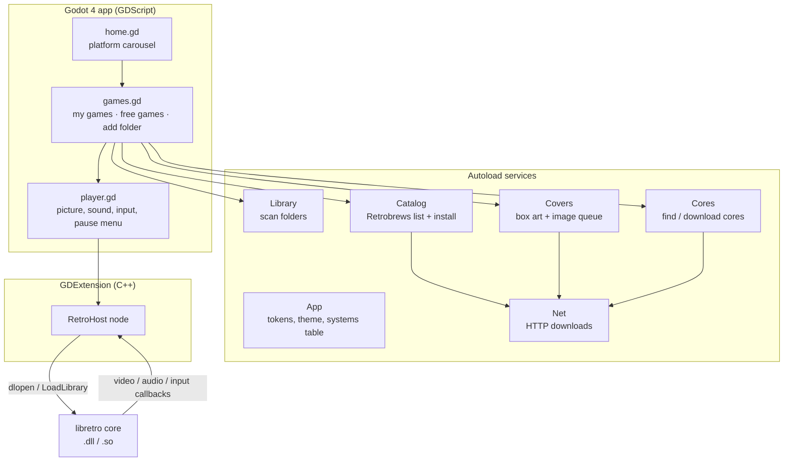
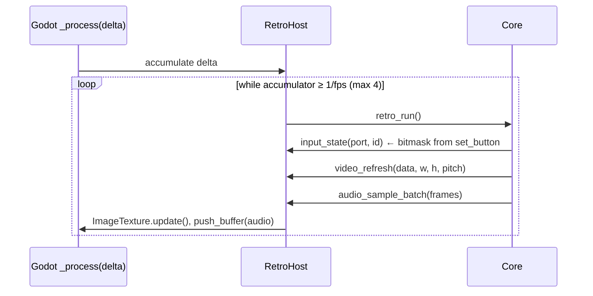

# RedoX Gaming: Technical Documentation

[Türkçe](TEKNIK.md) · **English**

This document explains how RedoX Gaming is built: the parts, how a frame travels from an emulator core to the screen, the online services, the files on disk, how to build every platform, and how to extend the app.

- [1. Architecture](#1-architecture)
- [2. Repository layout](#2-repository-layout)
- [3. The libretro host (C++)](#3-the-libretro-host-c)
- [4. Godot application](#4-godot-application)
- [5. Online services](#5-online-services)
- [6. Files on disk](#6-files-on-disk)
- [7. Building](#building)
- [8. Testing](#8-testing)
- [9. Extending](#9-extending)
- [10. Known limitations](#10-known-limitations)

---

## 1. Architecture



Three layers:

| Layer | Language | Job |
|---|---|---|
| **Interface** | GDScript (Godot 4.7) | screens, navigation, design system, online services |
| **RetroHost** | C++ (GDExtension, godot-cpp 4.5 API) | loads a libretro core, runs frames, converts video and audio, feeds input, save states |
| **Cores** | C/C++ (third party) | the actual emulators, one shared library per system |

The engine runs the **GL Compatibility** renderer (OpenGL 3.3 / OpenGL ES 3.0) so that cheap Android TV boxes work.

## 2. Repository layout

```
redox-gaming/
├── app/                          Godot project (open this folder in Godot)
│   ├── project.godot             settings, autoloads, splash, icon
│   ├── export_presets.cfg        Windows export preset
│   ├── redox_core.gdextension    which native library to load per platform
│   ├── bin/<platform>/           built RetroHost libraries (not in git)
│   ├── cores/<platform>/         optional bundled cores for development (not in git)
│   ├── roms/redox_test.nes       our own 145-byte test program
│   ├── assets/
│   │   ├── svg/                  logo, app icon, platform illustrations (pixel-art SVG)
│   │   ├── brand/                splash, .ico, Android launcher icons, TV banner
│   │   ├── fonts/                Press Start 2P, VT323 (OFL)
│   │   └── systems*/             raster sources of the icons
│   ├── scenes/                   home.tscn, games.tscn, player.tscn (root + script only)
│   ├── scripts/
│   │   ├── app.gd                design tokens, theme, systems table, helpers
│   │   ├── home.gd · games.gd · player.gd
│   │   ├── retro_input.gd        keyboard / gamepad → libretro joypad bits
│   │   ├── services/             net, cores, library, catalog, covers
│   │   └── ui/                   game_card.gd, hint_bar.gd
│   └── tests/                    smoke_test, services_test, svg_preview
├── extension/                    C++ GDExtension
│   ├── SConstruct
│   ├── godot-cpp/                git submodule (branch 4.5)
│   ├── include/libretro.h
│   └── src/                      retro_host.*, dynlib.*, register_types.cpp
├── art/                          original artwork (Gemini) used to generate assets
├── tools/                        Python scripts: icons, SVGs, brand files, test ROM, cores
└── docs/                         this file, design system, screenshots
```

## 3. The libretro host (C++)

`RetroHost` is a `Node` registered by the GDExtension. One instance owns one core at a time (libretro callbacks have no user pointer, so a static pointer routes them).

### 3.1 Public API (callable from GDScript)

| Method | Description |
|---|---|
| `load_core(path) -> bool` | opens the shared library, resolves all 21 `retro_*` symbols, calls `retro_set_environment` and `retro_init` |
| `load_game(path) -> bool` | reads the file (or passes the path when the core sets `need_fullpath`), calls `retro_load_game`, reads AV info, loads battery save, starts processing |
| `unload_game()` / `unload_core()` | writes the battery save, unloads |
| `reset()` | `retro_reset` |
| `set_paused(bool)` / `step_frame()` | pause the clock / run exactly one frame (used by tests) |
| `set_button(port, id, pressed)` / `clear_input()` | joypad state, ids are `RETRO_DEVICE_ID_JOYPAD_*` (0–15), ports 0–3 |
| `get_texture() -> ImageTexture` | the picture; the same texture object is updated in place every frame |
| `get_frame_image()`, `get_frame_size()`, `get_aspect_ratio()`, `get_fps()`, `get_sample_rate()` | frame info |
| `set_audio_playback(AudioStreamGeneratorPlayback)` | where sound is pushed |
| `set_system_directory(dir)` / `set_save_directory(dir)` | BIOS and battery-save folders handed to the core |
| `save_state() -> PackedByteArray` / `load_state(data) -> bool` | `retro_serialize` / `retro_unserialize` |
| `get_core_info() -> Dictionary` | name, version, extensions, fps, sample rate |
| signal `video_size_changed(Vector2i)` | emitted when the core changes resolution |

### 3.2 Frame loop



- **Timing:** the host accumulates real time and runs as many core frames as fit (at most 4 per Godot frame), so a 60.1 fps NES stays in step with a 60 Hz display. After a long stall the accumulator is reset instead of fast-forwarding.
- **Video:** the three libretro pixel formats (`XRGB8888`, `RGB565`, `0RGB1555`) are converted row by row (respecting `pitch`) into RGBA8, written into one reused `Image` and uploaded with `ImageTexture.update()`. A `NULL` frame (dupe) keeps the last picture.
- **Audio:** interleaved `int16` stereo becomes `Vector2` floats and is pushed into an `AudioStreamGeneratorPlayback` whose `mix_rate` equals the core's sample rate. If the buffer is full, that frame's audio is dropped rather than blocking.
- **Input:** the core can ask per button or for the whole bitmask (`RETRO_DEVICE_ID_JOYPAD_MASK`).

### 3.3 Environment commands handled

`GET_LOG_INTERFACE`, `SET_PIXEL_FORMAT`, `GET_CAN_DUPE`, `GET_SYSTEM_DIRECTORY`, `GET_SAVE_DIRECTORY`, `GET_INPUT_BITMASKS`, `SET_VARIABLES` (defaults are the first listed value), `GET_VARIABLE`, `GET_VARIABLE_UPDATE`, `SET_GEOMETRY`, `SET_SYSTEM_AV_INFO`, and the informational `SET_INPUT_DESCRIPTORS`, `SET_CONTROLLER_INFO`, `SET_SUPPORT_ACHIEVEMENTS`, `SET_PERFORMANCE_LEVEL`. Everything else returns `false`, which every supported core handles. Hardware-rendered cores (`SET_HW_RENDER`) are not supported yet.

### 3.4 Loading cores

`dynlib.cpp` wraps `LoadLibraryExW` (Windows, UTF-8 → UTF-16 path, `LOAD_LIBRARY_SEARCH_DLL_LOAD_DIR`) and `dlopen` (Linux / Android). It lives in its own file so `<windows.h>` never meets the godot-cpp headers.

## 4. Godot application

### 4.1 Screens

| Screen | Script | What it does |
|---|---|---|
| Home | `home.gd` | logo, platform carousel (wraps around, 180 ms slide, never auto-rotates), name, game count, position dots. Left/right, wheel, swipe, arrow buttons; A opens a platform. |
| Games | `games.gd` | tabs **OYUNLARIM** (own games) and **ÜCRETSİZ OYUNLAR** (store), **+ KLASÖR EKLE**; 5-column grid of `GameCard`s; detail dialog; core download dialog; B returns home on the same platform. |
| Player | `player.gd` | creates `RetroHost`, whole-number scaling with the core's aspect ratio, `AudioStreamGenerator`, input every frame, pause menu (resume, save state, load state, reset, back to library), toasts. |

All screens are built in code; the `.tscn` files only hold the root node and its script. Every screen is usable with D-pad + A/B; the design rules are in [DESIGN.md](DESIGN.md).

### 4.2 Input

`retro_input.gd` reads the keyboard and up to two gamepads every frame and writes a 16-bit mask per port. Face buttons map by **position** (SNES layout): bottom = B, right = A, left = Y, top = X; the left stick also drives the D-pad. Key presses are additionally **latched** from input events, so a tap shorter than one frame still reaches the game. Select + Start (or Guide) opens the pause menu.

### 4.3 Systems table

`App.SYSTEMS` is the single source of truth: id, display name, accent colour, core file name and extensions. Screens, the library scanner, the core downloader and the box-art lookup all read it.

## 5. Online services

All services are autoloads and use `Net`, which wraps `HTTPRequest` (threaded, with a progress callback, written to `*.part` then renamed).

### 5.1 Cores: downloaded on demand

`Cores.find(system)` looks in order at `res://cores/<platform>/` (development), `<exe folder>/cores/`, and `user://cores/<platform>/`.
`Cores.ensure(system)` downloads the missing core from the official buildbot and unzips it with `ZIPReader`:

| Platform | URL pattern |
|---|---|
| Windows x64 | `https://buildbot.libretro.com/nightly/windows/x86_64/latest/<core>_libretro.dll.zip` |
| Linux x64 | `https://buildbot.libretro.com/nightly/linux/x86_64/latest/<core>_libretro.so.zip` |
| Android arm64 | `https://buildbot.libretro.com/nightly/android/latest/arm64-v8a/<core>_libretro_android.so.zip` |

Cores are never committed or bundled; each keeps its own license.

### 5.2 Library: the player's games

`Library` scans, in this order: bundled `res://roms` (editor only; exports copy them to `user://roms` on first start), loose files in `user://roms`, `user://roms/<system>/`, and every folder the player added (stored in `user://library.json`, scanned recursively up to depth 6 / 20 000 files, nothing copied).
The system comes from the extension. Extensions shared by several systems (`.bin`, `.zip`) only count inside a folder whose name names the system (`Mega Drive`, `genesis`, `2600`, `arcade`, …).
Each game is `{path, system, title, cover, meta}`; `meta` comes from `user://meta/<system>/<name>.json` when present.

### 5.3 Catalog: free homebrew

[Retrobrews](https://retrobrews.github.io) keeps one GitHub repository per system with a `gamelist.xml` (EmulationStation format) plus the ROM, a screenshot and a text file per game.

| System | Repository |
|---|---|
| NES | `retrobrews/nes-games` |
| SNES | `retrobrews/snes-games` |
| GB / GBC | `retrobrews/gbc-games` (`.gb` files are filed under Game Boy) |
| GBA | `retrobrews/gba-games` |
| Mega Drive | `retrobrews/md-games` |
| Master System | `retrobrews/sms-games` |
| Atari 2600 | `retrobrews/atari2600-games` |

`Catalog.list(system)` downloads `gamelist.xml` (cached for 24 h, last copy used when offline) and parses it with `XMLParser`. `Catalog.install(entry)` downloads the ROM into `user://roms/<system>/`, copies the screenshot as cover, writes metadata JSON (title, developer, year, players, description, source) and rescans the library.

### 5.4 Covers: box art

For the player's own games, `Covers` downloads the directory listing of `https://thumbnails.libretro.com/<System>/Named_Boxarts/` once a week, normalises every title (drops `(…)`/`[…]` tags, moves a trailing `, The`, lowercases, keeps letters and digits) and matches the ROM file name. When several regions match, the preference is USA > World > Europe > Japan. Downloads run one at a time; failures are remembered for the session.
Some Retrobrews screenshots are JPEGs with a `.png` name, so `App.load_image_texture` detects the format from the file's first bytes.

## 6. Files on disk

`user://` is `%APPDATA%\Godot\app_userdata\RedoX Gaming\` on Windows, `~/.local/share/godot/app_userdata/RedoX Gaming/` on Linux and the app's private storage on Android.

| Path | Content |
|---|---|
| `roms/<system>/` | downloaded and bundled games |
| `cores/<platform>/` | downloaded libretro cores |
| `saves/` | battery saves (`<game>.srm`) |
| `states/` | save states (`<game>.state`) |
| `system/` | BIOS folder handed to cores (PlayStation BIOS goes here) |
| `covers/<system>/`, `covers/_index/` | box art and cached title lists |
| `catalog/` | cached `gamelist.xml` files and store screenshots |
| `meta/<system>/` | per-game metadata JSON |
| `library.json` | folders the player added |

## Building

### Requirements

| Tool | Version |
|---|---|
| Godot | 4.7.x (standard, not .NET) + export templates 4.7.x |
| Python + SCons | Python 3.8+, `pip install scons` |
| C++ compiler | Windows: Visual Studio 2022 Build Tools (MSVC) · Linux: GCC 11+ or Clang · Android: NDK r23+ |

```bash
git clone --recursive https://github.com/ByReoxXx/redox-gaming.git
# already cloned without --recursive?
git submodule update --init
```

### Windows

```bat
:: in a "x64 Native Tools Command Prompt for VS 2022"
cd extension
set PYTHONUTF8=1
scons platform=windows target=template_debug
scons platform=windows target=template_release
```

`PYTHONUTF8=1` avoids a SCons crash when MSVC prints messages in a non-English Windows code page.
Then run the project from the Godot editor (`app/`), or export:

```bash
godot --headless --path app --export-release "Windows Desktop" ../build/windows/RedoXGaming.exe
```

The result is `RedoXGaming.exe` (game data embedded) plus `redox_core.windows.template_release.x86_64.dll`; ship both in the same folder.

### Linux

```bash
cd extension
scons platform=linux target=template_release
```

Add a "Linux" export preset in Godot (*Project → Export*), then export. `libdl` is linked automatically.

### Android (TV and phone)

```bash
export ANDROID_HOME=/path/to/android-sdk     # NDK installed through the SDK manager
cd extension
scons platform=android arch=arm64 target=template_release
```

In Godot: *Project → Export → Add… → Android*, set the SDK path and a keystore, enable *Leanback* (TV) and use the launcher assets from `app/assets/brand/android/` (adaptive foreground/background, 192 px legacy icon, `tv_banner_320x180.png`). The Android build has not been tested yet; see [Known limitations](#10-known-limitations).

### Asset pipeline

| Script | Output |
|---|---|
| `tools/make_test_rom.py` | `app/roms/redox_test.nes`, a 145-byte NES program written in 6502 |
| `tools/make_system_icons.py` | the original 32 px pixel icons and `docs/system_icons.png` |
| `tools/cutout_icons.py` | removes the fake checkerboard from `art/gemini/*.jpg` → `app/assets/systems_hd/` |
| `tools/make_brand_assets.py` | logo cut-out, app icon, `.ico`, splash, Android icons, TV banner, store graphics |
| `tools/make_svgs.py` | pixel-art SVGs (one `<path>` per colour, `crispEdges`) in `app/assets/svg/` |
| `tools/fetch_cores.py` | optional: downloads cores into `app/cores/<platform>/` for development |

## 8. Testing

```bash
# core + test ROM: video, input, audio, save states, Turkish glyphs
godot --headless --path app -s res://tests/smoke_test.gd

# online services (needs internet): store list, install, core download + run, box art, folder scan
godot --headless --path app res://tests/services_test.tscn -- --frames=1500
#   -- --no-core   skips the core download step

# PNG vs SVG comparison sheet → user://svg_compare.png
godot --headless --path app -s res://tests/svg_preview.gd
```

Developer shortcuts for screenshots (each used once per launch): `-- --system=nes`, `--tab=store`, `--detail=8`, `--rom=<path>`, `--pause`. In Movie Maker mode (`--write-movie`) window input is ignored so stray key presses cannot change the recording.

## 9. Extending

**Add a system**

1. Add an entry to `App.SYSTEMS` (id, name, accent, core base name, extensions).
2. Add folder-name hints to `Library.FOLDER_HINTS` and, if needed, `FOLDER_ONLY_EXT`.
3. Add the thumbnail folder to `Covers.THUMB_SYSTEMS`.
4. Add a 512 px illustration in `art/gemini/<id>.jpg`, then run `cutout_icons.py` and `make_svgs.py`.
5. Optional: add a Retrobrews repository to `Catalog.REPOS`.

**Add a free game source:** implement `list(system)` and `install(entry)` like `Catalog`, returning the same entry dictionary. Only add sources whose games may be redistributed.

## 10. Known limitations

- Android TV / phone builds are not tested yet: the native folder picker, storage permissions and loading cores from app storage must be verified on a device.
- Cores that need hardware rendering (OpenGL/Vulkan through `SET_HW_RENDER`, e.g. some N64 / PSP cores) are not supported.
- No settings screen yet: controls cannot be remapped in the app, there are no shaders, and audio latency is fixed (100 ms buffer).
- Box art matching relies on No-Intro-style file names; there is no CRC lookup.
- Retrobrews' sharing permissions are taken from Retrobrews' own statement and were not verified game by game.
