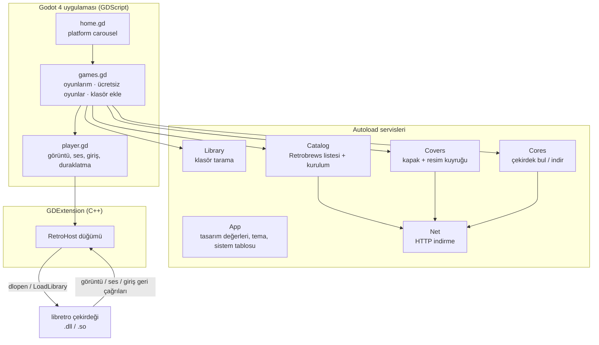
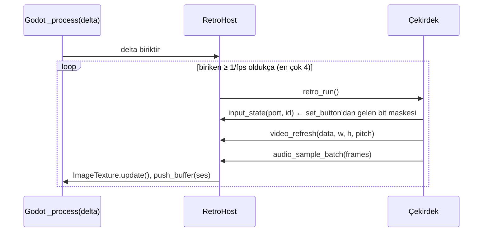

# RedoX Gaming: Teknik Doküman

**Türkçe** · [English](TECHNICAL.md)

Bu doküman RedoX Gaming'in nasıl kurulduğunu anlatır: parçalar, bir karenin emülatör çekirdeğinden ekrana nasıl gittiği, çevrimiçi servisler, diskteki dosyalar, her platform için derleme ve uygulamanın nasıl genişletileceği.

- [1. Mimari](#1-mimari)
- [2. Depo yapısı](#2-depo-yapısı)
- [3. libretro host (C++)](#3-libretro-host-c)
- [4. Godot uygulaması](#4-godot-uygulaması)
- [5. Çevrimiçi servisler](#5-çevrimiçi-servisler)
- [6. Diskteki dosyalar](#6-diskteki-dosyalar)
- [7. Derleme](#derleme)
- [8. Testler](#8-testler)
- [9. Genişletme](#9-genişletme)
- [10. Bilinen sınırlamalar](#10-bilinen-sınırlamalar)

---

## 1. Mimari



Üç katman var:

| Katman | Dil | Görev |
|---|---|---|
| **Arayüz** | GDScript (Godot 4.7) | ekranlar, gezinme, tasarım sistemi, çevrimiçi servisler |
| **RetroHost** | C++ (GDExtension, godot-cpp 4.5 API) | libretro çekirdeğini yükler, kareleri çalıştırır, görüntü ve sesi dönüştürür, girişi iletir, durum kaydı |
| **Çekirdekler** | C/C++ (üçüncü taraf) | asıl emülatörler, her sistem için bir paylaşımlı kütüphane |

Motor **GL Compatibility** çizicisiyle (OpenGL 3.3 / OpenGL ES 3.0) çalışır, böylece ucuz Android TV kutuları da desteklenir.

## 2. Depo yapısı

```
redox-gaming/
├── app/                          Godot projesi (Godot'da bu klasörü açın)
│   ├── project.godot             ayarlar, autoload'lar, açılış ekranı, ikon
│   ├── export_presets.cfg        Windows çıktı ayarı
│   ├── redox_core.gdextension    her platformda hangi yerel kütüphanenin yükleneceği
│   ├── bin/<platform>/           derlenen RetroHost kütüphaneleri (git'te yok)
│   ├── cores/<platform>/         geliştirme için isteğe bağlı çekirdekler (git'te yok)
│   ├── roms/redox_test.nes       kendi yazdığımız 145 baytlık test programı
│   ├── assets/
│   │   ├── svg/                  logo, uygulama ikonu, platform çizimleri (pixel art SVG)
│   │   ├── brand/                açılış ekranı, .ico, Android ikonları, TV banner'ı
│   │   ├── fonts/                Press Start 2P, VT323 (OFL)
│   │   └── systems*/             ikonların raster kaynakları
│   ├── scenes/                   home.tscn, games.tscn, player.tscn (yalnızca kök + betik)
│   ├── scripts/
│   │   ├── app.gd                tasarım değerleri, tema, sistem tablosu, yardımcılar
│   │   ├── home.gd · games.gd · player.gd
│   │   ├── retro_input.gd        klavye / gamepad → libretro joypad bitleri
│   │   ├── services/             net, cores, library, catalog, covers
│   │   └── ui/                   game_card.gd, hint_bar.gd
│   └── tests/                    smoke_test, services_test, svg_preview
├── extension/                    C++ GDExtension
│   ├── SConstruct
│   ├── godot-cpp/                git alt modülü (4.5 dalı)
│   ├── include/libretro.h
│   └── src/                      retro_host.*, dynlib.*, register_types.cpp
├── art/                          görsellerin üretildiği orijinal çizimler (Gemini)
├── tools/                        Python betikleri: ikonlar, SVG'ler, marka dosyaları, test ROM'u, çekirdekler
└── docs/                         bu dosya, tasarım sistemi, ekran görüntüleri
```

## 3. libretro host (C++)

`RetroHost`, GDExtension'ın kaydettiği bir `Node`'dur. Bir örnek aynı anda tek bir çekirdeğe sahip olur (libretro geri çağrılarında kullanıcı işaretçisi olmadığı için yönlendirme statik bir işaretçiyle yapılır).

### 3.1 Açık API (GDScript'ten çağrılabilir)

| Metot | Açıklama |
|---|---|
| `load_core(path) -> bool` | paylaşımlı kütüphaneyi açar, 21 `retro_*` fonksiyonunun hepsini bulur, `retro_set_environment` ve `retro_init`'i çağırır |
| `load_game(path) -> bool` | dosyayı okur (çekirdek `need_fullpath` isterse yolu verir), `retro_load_game`'i çağırır, görüntü/ses bilgisini alır, pil kaydını yükler, çalışmaya başlar |
| `unload_game()` / `unload_core()` | pil kaydını yazar, kapatır |
| `reset()` | `retro_reset` |
| `set_paused(bool)` / `step_frame()` | saati durdurur / tam bir kare çalıştırır (testlerde kullanılır) |
| `set_button(port, id, pressed)` / `clear_input()` | joypad durumu; id'ler `RETRO_DEVICE_ID_JOYPAD_*` (0–15), portlar 0–3 |
| `get_texture() -> ImageTexture` | görüntü; aynı texture nesnesi her karede yerinde güncellenir |
| `get_frame_image()`, `get_frame_size()`, `get_aspect_ratio()`, `get_fps()`, `get_sample_rate()` | kare bilgisi |
| `set_audio_playback(AudioStreamGeneratorPlayback)` | sesin gönderileceği yer |
| `set_system_directory(dir)` / `set_save_directory(dir)` | çekirdeğe verilen BIOS ve pil kaydı klasörleri |
| `save_state() -> PackedByteArray` / `load_state(data) -> bool` | `retro_serialize` / `retro_unserialize` |
| `get_core_info() -> Dictionary` | ad, sürüm, uzantılar, fps, örnekleme hızı |
| `video_size_changed(Vector2i)` sinyali | çekirdek çözünürlüğü değiştirince gelir |

### 3.2 Kare döngüsü



- **Zamanlama:** host gerçek zamanı biriktirir ve sığan kadar çekirdek karesi çalıştırır (Godot karesi başına en çok 4). Böylece 60,1 fps'lik NES, 60 Hz ekranla uyumlu kalır. Uzun bir duraklamadan sonra hızlı ileri sarmak yerine birikim sıfırlanır.
- **Görüntü:** üç libretro piksel biçimi (`XRGB8888`, `RGB565`, `0RGB1555`) satır satır (`pitch`'e uyarak) RGBA8'e çevrilir, yeniden kullanılan tek bir `Image`'a yazılır ve `ImageTexture.update()` ile yüklenir. `NULL` kare (tekrar) son görüntüyü korur.
- **Ses:** iç içe `int16` stereo, `Vector2` float'lara çevrilir ve `mix_rate`'i çekirdeğin örnekleme hızına eşit bir `AudioStreamGeneratorPlayback`'e gönderilir. Tampon doluysa beklemek yerine o karenin sesi atlanır.
- **Giriş:** çekirdek düğme düğme ya da tüm maskeyi bir kerede (`RETRO_DEVICE_ID_JOYPAD_MASK`) sorabilir.

### 3.3 Desteklenen environment komutları

`GET_LOG_INTERFACE`, `SET_PIXEL_FORMAT`, `GET_CAN_DUPE`, `GET_SYSTEM_DIRECTORY`, `GET_SAVE_DIRECTORY`, `GET_INPUT_BITMASKS`, `SET_VARIABLES` (varsayılan, listedeki ilk değerdir), `GET_VARIABLE`, `GET_VARIABLE_UPDATE`, `SET_GEOMETRY`, `SET_SYSTEM_AV_INFO` ve bilgi amaçlı `SET_INPUT_DESCRIPTORS`, `SET_CONTROLLER_INFO`, `SET_SUPPORT_ACHIEVEMENTS`, `SET_PERFORMANCE_LEVEL`. Diğerleri `false` döner; desteklenen bütün çekirdekler bunu sorunsuz karşılar. Donanım çizimli çekirdekler (`SET_HW_RENDER`) henüz desteklenmiyor.

### 3.4 Çekirdek yükleme

`dynlib.cpp`, `LoadLibraryExW` (Windows; UTF-8 → UTF-16 yol, `LOAD_LIBRARY_SEARCH_DLL_LOAD_DIR`) ve `dlopen` (Linux / Android) çağrılarını sarar. `<windows.h>` godot-cpp başlıklarıyla karşılaşmasın diye ayrı bir dosyadadır.

## 4. Godot uygulaması

### 4.1 Ekranlar

| Ekran | Betik | Ne yapar |
|---|---|---|
| Ana ekran | `home.gd` | logo, platform carousel (sonda başa döner, 180 ms kayar, kendi kendine dönmez), ad, oyun sayısı, konum noktaları. Sol/sağ, fare tekerleği, kaydırma, ok düğmeleri; A platformu açar. |
| Oyunlar | `games.gd` | **OYUNLARIM** ve **ÜCRETSİZ OYUNLAR** sekmeleri, **+ KLASÖR EKLE**; 5 sütunlu `GameCard` ızgarası; detay penceresi; çekirdek indirme penceresi; B aynı platformda ana ekrana döner. |
| Oyun | `player.gd` | `RetroHost`'u oluşturur, çekirdeğin en-boy oranıyla tam sayı ölçekler, `AudioStreamGenerator`, her karede giriş, duraklatma menüsü (devam, durum kaydet, durum yükle, sıfırla, kütüphaneye dön), bildirimler. |

Bütün ekranlar kodla kurulur; `.tscn` dosyaları yalnızca kök düğümü ve betiğini tutar. Her ekran yön tuşu + A/B ile kullanılabilir; tasarım kuralları [DESIGN.md](DESIGN.md)'de.

### 4.2 Giriş

`retro_input.gd` her karede klavyeyi ve en çok iki gamepad'i okur, her port için 16 bitlik bir maske yazar. Yüz düğmeleri **konuma göre** eşlenir (SNES düzeni): alt = B, sağ = A, sol = Y, üst = X; sol çubuk da yön tuşu gibi çalışır. Tuş basışları ayrıca giriş olaylarından **mandallanır**, böylece bir kareden kısa basışlar da oyuna ulaşır. Select + Start (ya da Guide) duraklatma menüsünü açar.

### 4.3 Sistem tablosu

`App.SYSTEMS` tek doğruluk kaynağıdır: id, görünen ad, vurgu rengi, çekirdek dosya adı ve uzantılar. Ekranlar, kütüphane tarayıcısı, çekirdek indirici ve kapak araması hep bunu okur.

## 5. Çevrimiçi servisler

Bütün servisler autoload'dur ve `Net`'i kullanır. `Net`, `HTTPRequest`'i sarar: iş parçacıklı çalışır, ilerleme bildirir, önce `*.part` dosyasına yazar sonra adını değiştirir.

### 5.1 Çekirdekler: ihtiyaç anında indirilir

`Cores.find(sistem)` sırasıyla şuralara bakar: `res://cores/<platform>/` (geliştirme), `<exe klasörü>/cores/` ve `user://cores/<platform>/`.
`Cores.ensure(sistem)` eksik çekirdeği resmî buildbot'tan indirir ve `ZIPReader` ile açar:

| Platform | URL kalıbı |
|---|---|
| Windows x64 | `https://buildbot.libretro.com/nightly/windows/x86_64/latest/<core>_libretro.dll.zip` |
| Linux x64 | `https://buildbot.libretro.com/nightly/linux/x86_64/latest/<core>_libretro.so.zip` |
| Android arm64 | `https://buildbot.libretro.com/nightly/android/latest/arm64-v8a/<core>_libretro_android.so.zip` |

Çekirdekler depoya konmaz ve pakete eklenmez; her biri kendi lisansını korur.

### 5.2 Library: oyuncunun oyunları

`Library` sırasıyla şunları tarar: paketteki `res://roms` (yalnızca editörde; dışa aktarılan sürüm bunları ilk açılışta `user://roms`'a kopyalar), `user://roms`'taki tek dosyalar, `user://roms/<sistem>/` ve oyuncunun eklediği her klasör. Eklenen klasörler `user://library.json`'da tutulur ve özyinelemeli taranır (en çok 6 derinlik / 20 000 dosya); hiçbir şey kopyalanmaz.
Sistem uzantıdan anlaşılır. Birden çok sistemin kullandığı uzantılar (`.bin`, `.zip`) yalnızca adı sistemi belli eden bir klasördeyse sayılır (`Mega Drive`, `genesis`, `2600`, `arcade`, …).
Her oyun `{path, system, title, cover, meta}` biçimindedir; `meta`, varsa `user://meta/<sistem>/<ad>.json`'dan gelir.

### 5.3 Catalog: ücretsiz homebrew

[Retrobrews](https://retrobrews.github.io) her sistem için bir GitHub deposu tutar. Depoda bir `gamelist.xml` (EmulationStation biçimi), ayrıca her oyun için ROM, ekran görüntüsü ve metin dosyası bulunur.

| Sistem | Depo |
|---|---|
| NES | `retrobrews/nes-games` |
| SNES | `retrobrews/snes-games` |
| GB / GBC | `retrobrews/gbc-games` (`.gb` dosyaları Game Boy altına konur) |
| GBA | `retrobrews/gba-games` |
| Mega Drive | `retrobrews/md-games` |
| Master System | `retrobrews/sms-games` |
| Atari 2600 | `retrobrews/atari2600-games` |

`Catalog.list(sistem)`, `gamelist.xml`'i indirir (24 saat önbellekte tutulur, çevrimdışıyken son kopya kullanılır) ve `XMLParser` ile okur. `Catalog.install(oyun)` ROM'u `user://roms/<sistem>/`'e indirir, ekran görüntüsünü kapak olarak kopyalar, bilgi JSON'unu yazar (ad, geliştirici, yıl, oyuncu sayısı, açıklama, kaynak) ve kütüphaneyi yeniden tarar.

### 5.4 Covers: kapak resimleri

Oyuncunun kendi oyunları için `Covers`, `https://thumbnails.libretro.com/<Sistem>/Named_Boxarts/` klasörünün listesini haftada bir indirir. Her başlığı sadeleştirir: `(…)`/`[…]` etiketlerini atar, sondaki `, The`'yi başa alır, küçük harfe çevirir, yalnızca harf ve rakamları bırakır. Sonra ROM dosya adıyla eşleştirir. Birden çok bölge eşleşirse tercih ABD > Dünya > Avrupa > Japonya'dır. İndirmeler tek tek yapılır; başarısız olanlar oturum boyunca hatırlanır.
Bazı Retrobrews ekran görüntüleri `.png` adlı JPEG dosyalarıdır; bu yüzden `App.load_image_texture` biçimi dosyanın ilk baytlarından anlar.

## 6. Diskteki dosyalar

`user://` Windows'ta `%APPDATA%\Godot\app_userdata\RedoX Gaming\`, Linux'ta `~/.local/share/godot/app_userdata/RedoX Gaming/`, Android'de uygulamanın özel depolama alanıdır.

| Yol | İçerik |
|---|---|
| `roms/<sistem>/` | indirilen ve paketle gelen oyunlar |
| `cores/<platform>/` | indirilen libretro çekirdekleri |
| `saves/` | pil kayıtları (`<oyun>.srm`) |
| `states/` | durum kayıtları (`<oyun>.state`) |
| `system/` | çekirdeklere verilen BIOS klasörü (PlayStation BIOS'u buraya) |
| `covers/<sistem>/`, `covers/_index/` | kapak resimleri ve önbellekteki başlık listeleri |
| `catalog/` | önbellekteki `gamelist.xml` dosyaları ve mağaza ekran görüntüleri |
| `meta/<sistem>/` | oyun başına bilgi JSON'u |
| `library.json` | oyuncunun eklediği klasörler |

## Derleme

### Gereksinimler

| Araç | Sürüm |
|---|---|
| Godot | 4.7.x (standart, .NET değil) + 4.7.x export şablonları |
| Python + SCons | Python 3.8+, `pip install scons` |
| C++ derleyici | Windows: Visual Studio 2022 Build Tools (MSVC) · Linux: GCC 11+ ya da Clang · Android: NDK r23+ |

```bash
git clone --recursive https://github.com/ByReDoxXx/redox-gaming.git
# --recursive olmadan klonladıysanız:
git submodule update --init
```

### Windows

```bat
:: "x64 Native Tools Command Prompt for VS 2022" içinde
cd extension
set PYTHONUTF8=1
scons platform=windows target=template_debug
scons platform=windows target=template_release
```

`PYTHONUTF8=1`, MSVC Türkçe gibi İngilizce olmayan bir Windows'ta mesaj yazdığında SCons'un çökmesini önler.
Sonra projeyi Godot editöründen (`app/`) çalıştırın ya da dışa aktarın:

```bash
godot --headless --path app --export-release "Windows Desktop" ../build/windows/RedoXGaming.exe
```

Sonuç, içine oyun verisi gömülü `RedoXGaming.exe` ve `redox_core.windows.template_release.x86_64.dll`'dir; ikisini aynı klasörde dağıtın.

### Linux

```bash
cd extension
scons platform=linux target=template_release
```

Godot'da bir "Linux" çıktı ayarı ekleyin (*Proje → Dışa Aktar*) ve dışa aktarın. `libdl` otomatik bağlanır.

### Android (TV ve telefon)

```bash
export ANDROID_HOME=/android-sdk/yolu      # NDK, SDK yöneticisinden kurulu olmalı
cd extension
scons platform=android arch=arm64 target=template_release
```

Godot'da: *Proje → Dışa Aktar → Ekle… → Android*; SDK yolunu ve bir keystore'u ayarlayın, *Leanback*'i (TV) açın ve `app/assets/brand/android/`'deki ikonları kullanın (adaptif ön/arka plan, 192 px eski ikon, `tv_banner_320x180.png`). Android sürümü henüz test edilmedi; bkz. [Bilinen sınırlamalar](#10-bilinen-sınırlamalar).

### Görsel üretim hattı

| Betik | Çıktı |
|---|---|
| `tools/make_test_rom.py` | `app/roms/redox_test.nes`: 6502 ile yazılmış 145 baytlık NES programı |
| `tools/make_system_icons.py` | ilk 32 px pixel ikonlar ve `docs/system_icons.png` |
| `tools/cutout_icons.py` | `art/gemini/*.jpg`'deki sahte damaları temizler → `app/assets/systems_hd/` |
| `tools/make_brand_assets.py` | logo kesimi, uygulama ikonu, `.ico`, açılış ekranı, Android ikonları, TV banner'ı, mağaza görselleri |
| `tools/make_svgs.py` | `app/assets/svg/`'deki pixel art SVG'ler (her renk için bir `<path>`, `crispEdges`) |
| `tools/fetch_cores.py` | isteğe bağlı: geliştirme için çekirdekleri `app/cores/<platform>/`'a indirir |

## 8. Testler

```bash
# çekirdek + test ROM'u: görüntü, giriş, ses, durum kaydı, Türkçe harfler
godot --headless --path app -s res://tests/smoke_test.gd

# çevrimiçi servisler (internet gerekir): mağaza listesi, kurulum, çekirdek indirip çalıştırma, kapak, klasör tarama
godot --headless --path app res://tests/services_test.tscn -- --frames=1500
#   -- --no-core   çekirdek indirme adımını atlar

# PNG ve SVG karşılaştırma görseli → user://svg_compare.png
godot --headless --path app -s res://tests/svg_preview.gd
```

Ekran görüntüleri için geliştirici kısayolları (her biri açılış başına bir kez çalışır): `-- --system=nes`, `--tab=store`, `--detail=8`, `--rom=<yol>`, `--pause`. Movie Maker modunda (`--write-movie`) pencere girdisi yok sayılır, böylece kazara basılan tuşlar kaydı bozmaz.

## 9. Genişletme

**Yeni bir sistem eklemek**

1. `App.SYSTEMS`'e bir kayıt ekleyin (id, ad, vurgu rengi, çekirdek adı, uzantılar).
2. `Library.FOLDER_HINTS`'e klasör adı ipuçlarını, gerekirse `FOLDER_ONLY_EXT`'e uzantıları ekleyin.
3. Kapak klasörünü `Covers.THUMB_SYSTEMS`'e ekleyin.
4. `art/gemini/<id>.jpg` olarak 512 px bir çizim ekleyin, sonra `cutout_icons.py` ve `make_svgs.py`'yi çalıştırın.
5. İsteğe bağlı: `Catalog.REPOS`'a bir Retrobrews deposu ekleyin.

**Yeni bir ücretsiz oyun kaynağı:** `Catalog` gibi `list(sistem)` ve `install(oyun)` yazın, aynı oyun sözlüğünü döndürün. Yalnızca oyunları yeniden dağıtılabilen kaynakları ekleyin.

## 10. Bilinen sınırlamalar

- Android TV / telefon sürümleri henüz test edilmedi: klasör seçici, depolama izinleri ve çekirdeklerin uygulama alanından yüklenmesi bir cihazda doğrulanmalı.
- Donanım çizimi isteyen çekirdekler (`SET_HW_RENDER` ile OpenGL/Vulkan; bazı N64 / PSP çekirdekleri gibi) desteklenmiyor.
- Henüz ayarlar ekranı yok: tuşlar uygulama içinden yeniden atanamıyor, shader yok, ses gecikmesi sabit (100 ms tampon).
- Kapak eşleştirme No-Intro tarzı dosya adlarına dayanıyor; CRC ile arama yok.
- Retrobrews'teki paylaşım izinleri Retrobrews'ün kendi beyanına dayanıyor, oyun oyun doğrulanmadı.
