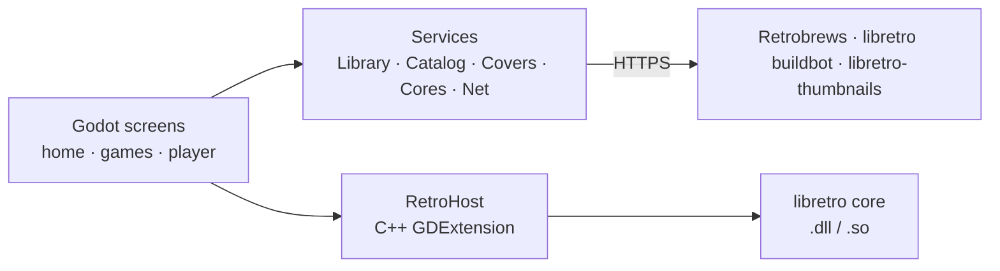

**English** · [Türkçe](Mimari)

# Architecture

| Part | Where | In one sentence |
|---|---|---|
| Screens | `app/scripts/home.gd`, `games.gd`, `player.gd` | built in code, D-pad first, styled by tokens in `app.gd` |
| RetroHost | `extension/src/retro_host.cpp` | loads one libretro core, runs it at its own frame rate, converts its picture to a texture and its sound to Godot audio |
| Library | `services/library.gd` | finds the player's games in app folders and added folders |
| Catalog | `services/catalog.gd` | reads Retrobrews' `gamelist.xml` per system and installs a game with its screenshot and details |
| Covers | `services/covers.gd` | matches file names to libretro-thumbnails box art |
| Cores | `services/cores.gd` | finds a core or downloads it once from the libretro buildbot |
| Net | `services/net.gd` | HTTP downloads with progress |

## Life of a frame

1. Godot calls `RetroHost._process(delta)`.
2. The host adds `delta` to a clock and calls `retro_run()` as many times as one core frame fits (60.1 fps for NES).
3. During `retro_run()` the core asks for buttons, hands over a picture and a batch of sound.
4. The picture is converted to RGBA and uploaded into one `ImageTexture`; the sound goes into an `AudioStreamGenerator`.
5. The player screen shows the texture at a whole-number scale.

## Why these choices

| Choice | Reason |
|---|---|
| Godot 4 | one project for Windows, Linux, Android TV and phones; good at pixel art; gamepad and focus navigation built in |
| libretro cores | mature, accurate emulators with one shared API; a new system is just a new core |
| C++ only for the host | the per-frame work (pixel conversion, audio) stays fast; everything else is easy to change in GDScript |
| GL Compatibility renderer | runs on low-end Android TV boxes |
| Cores downloaded, not bundled | smaller download, and each core keeps its own license |

Full reference: [docs/TECHNICAL.md](https://github.com/ByReDoxXx/redox-gaming/blob/main/docs/TECHNICAL.md).
