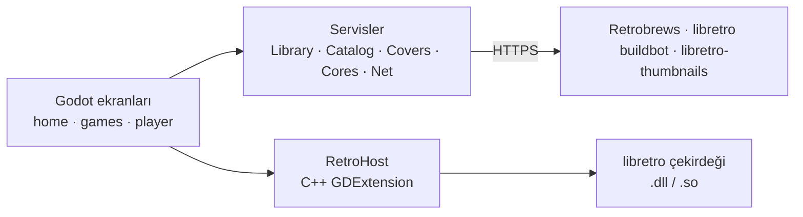

[English](Architecture) · **Türkçe**

# Mimari

| Parça | Yeri | Tek cümlede |
|---|---|---|
| Ekranlar | `app/scripts/home.gd`, `games.gd`, `player.gd` | kodla kurulur, önce yön tuşu düşünülür, `app.gd`'deki tasarım değerleriyle stillenir |
| RetroHost | `extension/src/retro_host.cpp` | bir libretro çekirdeği yükler, kendi kare hızında çalıştırır, görüntüsünü texture'a, sesini Godot sesine çevirir |
| Library | `services/library.gd` | oyuncunun oyunlarını uygulama klasörlerinde ve eklenen klasörlerde bulur |
| Catalog | `services/catalog.gd` | her sistem için Retrobrews `gamelist.xml`'ini okur, oyunu ekran görüntüsü ve bilgileriyle kurar |
| Covers | `services/covers.gd` | dosya adlarını libretro-thumbnails kapaklarıyla eşleştirir |
| Cores | `services/cores.gd` | çekirdeği bulur ya da libretro buildbot'tan bir kez indirir |
| Net | `services/net.gd` | ilerleme bildiren HTTP indirmeleri |

## Bir karenin yolculuğu

1. Godot, `RetroHost._process(delta)`'yı çağırır.
2. Host `delta`'yı bir saate ekler ve bir çekirdek karesi sığdıkça `retro_run()`'ı çağırır (NES için 60,1 fps).
3. `retro_run()` sırasında çekirdek düğmeleri sorar, bir görüntü ve bir parça ses verir.
4. Görüntü RGBA'ya çevrilip tek bir `ImageTexture`'a yüklenir; ses bir `AudioStreamGenerator`'a gider.
5. Oyun ekranı texture'ı tam sayı katında büyüterek gösterir.

## Neden bu seçimler

| Seçim | Neden |
|---|---|
| Godot 4 | Windows, Linux, Android TV ve telefon için tek proje; pixel art'ta iyi; gamepad ve odakla gezinme hazır |
| libretro çekirdekleri | olgun, doğru çalışan emülatörler ve tek ortak API; yeni sistem = yeni çekirdek |
| C++ yalnızca host için | kare başına yapılan iş (piksel dönüşümü, ses) hızlı kalır; geri kalan her şey GDScript'te kolayca değişir |
| GL Compatibility çizicisi | düşük donanımlı Android TV kutularında çalışır |
| Çekirdekler pakete konmaz, iner | indirme küçük kalır ve her çekirdek kendi lisansını korur |

Tam başvuru: [docs/TEKNIK.md](https://github.com/ByReoxXx/redox-gaming/blob/main/docs/TEKNIK.md).
